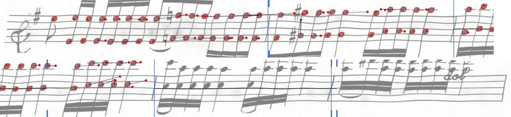
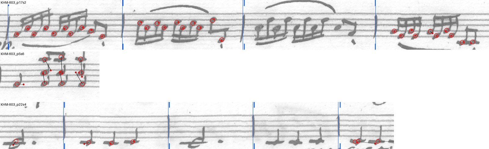
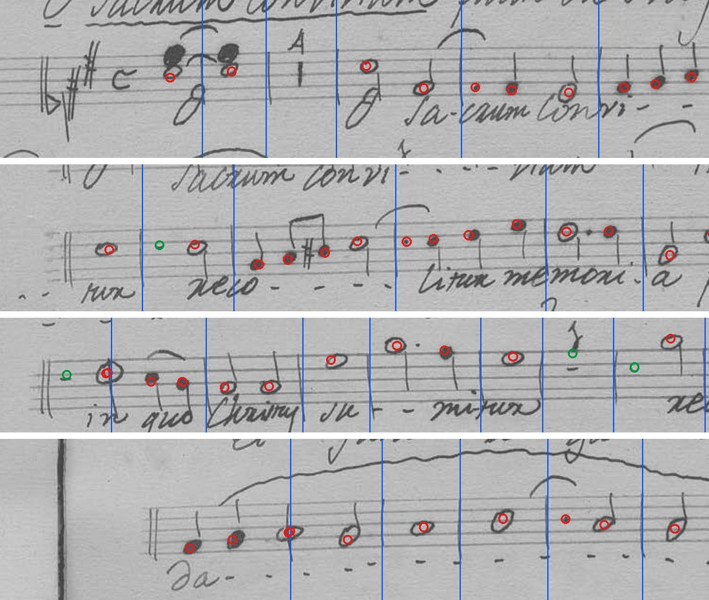

# The pointer: the reader says where each symbol is (2026-10-19)

**Verdict: it works, and the reader didn't need retraining.** We added a
small head to musvit-D3 and trained only the head, with D3 frozen. It places
93% of notes within half a staff space on rendered staves of music it never
trained on. On KHM 603's good bars, 93% of its notes land within half a
space of the classical map's. On notes it is less precise than the
classical map (median 0.10 space against 0.07), but it places every rest. The
map misses 23–35% of rests and misplaces the copyist-style ones. Most of
the pointer's misses slip sideways, and the worst staves are runs of
repeated notes. On Berlin, one staff of triple stops had its chord notes
pulled toward the middle one. Adding Dolores raised the pointer's score on
Dolores (70% to 81% of notes) and left our sets flat. Three things are
untried: pointing from D3's own reading, keeping places in left-to-right
order, and stage B.

## What we tried

**The question.** D3 writes out a staff's symbols but never learned to point
at them. So tying a reading to the ink became a separate job, built by hand
from staff lines, heights and ink (the classical map). Option 1 asks D3 to
point: each symbol it reads also gives its place on the staff.

**It's forced alignment, not reading.** The reading is known, so the reader
is teacher-forced on it. In training the reading is the true LMX. In use
it would be D3's own reading, or the edited one. The whole staff is done at
once, as D3 reads it.

**Which symbols get a place:**
- **a note:** its pitch token (each note of a chord has its own);
- **a rest:** its `rest` token;
- **a bar line:** the `measure` token of the bar after it.

Other tokens get no place.

**The head** (`experiments/musvit/pointer.py`, class `Pointer`, 0.39 M
parameters):
- **The query** comes from two decoder states: the one where D3 writes the
  symbol, and the one after, which has seen it.
- **The attention:** the query attends over the encoder's patches.
- **The place** is the attention's expected patch centre, plus an offset.
  The offset comes from the query and what it attended to, capped at 1.5
  patches.

**The losses:**
- **Cross-entropy** of the attention against the patch holding the target.
  For bar lines and Berlin's rests, only the target's column counts, since
  their place is sideways only.
- **The distance** from the target, in staff spaces (Huber, δ 0.5).

**Stage A** (run `ptrA1`): D3 frozen, only the head trains. This asks
whether D3 already knows where things are. It ran 6 epochs on a Modal L4,
with lr 3e-4 and batches of 8. **Stage B,** with the decoder trained too and
its reading loss kept, wasn't run: stage A wasn't weak. It would also need
the clean-test reading check.

## Data and scoring

Each staff is a JPEG, its LMX, and a `.pos.json` file holding each target's
token, kind and place. `experiments/synth/pos_data.py` builds all three
kinds.

| Set | Staves | Targets | Where the places come from |
|---|---:|---|---|
| **Rendered, copyist style**: train / test | 3,000 / 200 | test: 3,547 notes, 733 rests, 788 bar lines, 39 grace notes | The engraving. Each drawn symbol is tied to its element in Verovio's SVG, then to the LMX bar by bar. |
| **Rendered, plain fonts**: train / test | 3,000 / 200 | test: 3,928 notes, 677 rests, 796 bar lines, 41 grace notes | The same, in Verovio's five fonts. |
| **Berlin**: KHM 602 train / KHM 603 test | 104 / 42 | 603: 258 notes, 18 rests, 214 bar lines | Notes and rests from the classical map, in its good bars only. Bar lines from the editor's labels, all of them. |
| **Dolores**: train / test | 6,287 / 400 | test: 9,366 notes, 1,811 rests, 2,787 bar lines, 102 grace notes | The centre of each symbol's stylus polygon. MusiCorpus links each polygon to its MusicXML note or measure. |

- **Rendered staves:** the music is the quartet staves held out of the SAM
  synthetic sets (`heldout.txt`). Training draws from the first 38,000
  staves, from 95 scores. The test draws from the remaining 4,054, from 7
  other scores, by Schubert, Spohr and Viotti. A bar gives no note targets
  if any note lands more than 0.35 space off its line or space. That
  dropped 3.3% of copyist-style bars and 2.4% of plain ones.
- **Berlin:** the good bars are `sam_data.good_bars`. They are 187 of KHM
  602's 793 bars and 63 of KHM 603's 256. So on Berlin the yardstick for
  notes and rests is the classical map, not the truth. D3 itself trained on
  every labelled staff except the clean test, KHM 603's first movement
  (`experiments/musvit/BRIEF.md`). The head never saw KHM 603.
- **Dolores:** 1,209 handwritten pages from five Catalan archives, by 18
  composers and 78 scribal hands, mostly 1750–1900. 98% are copies, and 82%
  are single-staff parts. Most are sacred music (Compline, Mass, Requiem,
  Salve), plus galops, waltzes and polkas. The licence is CC BY-NC-SA. Its
  staves were shrunk to 256 px high before upload.

**Scoring.** Each target gets a distance from the pointer's place, in staff
spaces. Bar lines and Berlin's rests are scored on x only; the rest on x and
y. Each cell below is the median distance, then the share within half a
space.

**The classical map as a yardstick.** `experiments/synth/pos_score.py` runs
the map (`align.py`'s steps, then `segment.py`'s rest finding) on the
rendered test staves. It is scored the same way against the same exact
places. The map is given the true bar lines and where the opening ends,
since on a real staff the labels give it both. So its bar lines aren't
scored. Its rests are scored on x only, since it places rests sideways.

## Results

### Stage A (`ptrA1`, D3 frozen, epoch 6)

| Test set | Notes | Rests | Bar lines | Grace notes |
|---|---|---|---|---|
| Rendered, copyist style | 0.10, 93% | 0.13, 94% | 0.07, 94% | 0.15, 90% |
| Rendered, plain fonts | 0.08, 92% | 0.10, 92% | 0.06, 95% | 0.17, 88% |
| KHM 603, against the map | 0.19, 93% | x only: 0.20, 72% | 0.09, 94% | |
| Dolores test, not trained on (`ptrA1-eval`) | 0.33, 70% | 0.55, 45% | 0.29, 70% | 0.94, 31% |

- **Rendered rows:** exact truth on music the head never saw. The first
  epoch already had 86% (copyist style) and 85% (plain) of notes within
  half a space.
- **KHM 603:** agreement with the classical map, in its good bars. Notes
  rose from 84% at epoch 1 to 93%. The rests are 13 of 18 at every epoch,
  too few to read much into.
- **Dolores:** the same head, scored on a set it never trained on. Its
  notes are 0.22 space off sideways and 0.16 up or down
  (medians).

### Against the classical map, same symbols, exact truth

Only symbols the map placed are counted here.

| Rendered test | Symbols | Map | Pointer | Map missed |
|---|---:|---|---|---:|
| Copyist style, notes | 3,488 | 0.07, 91% | 0.10, 93% | 59 of 3,547 |
| Copyist style, rests (x only) | 566 | 1.59, 38% | 0.09, 96% | 167 of 733 |
| Copyist style, grace notes | 38 | 0.07, 97% | 0.15, 89% | 1 of 39 |
| Plain fonts, notes | 3,861 | 0.05, 98% | 0.08, 92% | 67 of 3,928 |
| Plain fonts, rests (x only) | 439 | 0.03, 77% | 0.06, 94% | 238 of 677 |
| Plain fonts, grace notes | 40 | 0.05, 93% | 0.17, 88% | 1 of 41 |

- **Notes:** the map is more precise. Its median error is about two thirds
  of the pointer's. On plain fonts more of its notes land within half a
  space (98% against 92%). On the copyist style fewer do (91% against 93%).
- **Rests:** the pointer wins. The map never finds 23% (copyist style) and
  35% (plain) of the rests. Of the copyist-style rests it does find, it puts
  the median one 1.59 spaces off.
- **Grace notes:** the map is better, on about 40 of each.
- **The map may be slightly flattered.** Code review on 2026-10-20 found
  that `pos_data.py` gives the map each rendered staff's first bar as
  starting at its first symbol. Its docstring says a space before; real
  labels start earlier. A tighter first bar helps the map place that bar's
  notes, so its margin on notes may be a little smaller than shown.

### Adding Dolores (`ptrA2-dolores`, stage A, epoch 6)

The same recipe, with Dolores's 6,287 training staves added (12,391 in
all).

| Test set | Notes | Rests | Bar lines |
|---|---|---|---|
| Dolores, before → after | 0.33, 70% → 0.24, 81% | 0.55, 45% → 0.36, 68% | 0.29, 70% → 0.16, 84% |
| Copyist style, before → after | 0.10, 93% → 0.10, 93% | 0.13, 94% → 0.13, 94% | 0.07, 94% → 0.07, 93% |
| Plain fonts, before → after | 0.08, 92% → 0.09, 93% | 0.10, 92% → 0.11, 92% | 0.06, 95% → 0.07, 95% |
| KHM 603, before → after | 0.19, 93% → 0.17, 93% | 0.20, 72% → 0.22, 78% | 0.09, 94% → 0.07, 94% |

- **Dolores** gained on everything. Grace notes went from 31% to 58%.
- **Our sets** moved by a point or less. KHM 603's rests went from 13 of 18
  to 14.
- **Part of what's left on Dolores is the polygons.** A polygon's centre
  sits a median 0.19 space from its head's ink (p90 0.46), measured on
  3,265 filled heads. The polygons are rough circles, a median 2.9 by 2.8
  spaces.

## Where it goes wrong

**Sideways, at the right height.** On the rendered tests, 251 notes
(copyist style) and 298 (plain) miss by more than half a space.
- **Sideways:** 213 (85%) and 277 (93%) of those are off by more than half
  a space in x.
- **Far:** 95 and 123 are more than 2 spaces off sideways, a median 4.5
  and 3.8 spaces. Yet their height is right: a median 0.10 and 0.06 space
  off.
- **Bunched in a few staves:** on the copyist-style test, 3 of the 200
  staves hold 38 of the 95. All three are runs of repeated notes: octaves
  on E and F, repeated F5s, and repeated A3s.

The worst is a run of repeated octaves, in the copyist style:



*Rings are the true places; dots are the pointer's; a black line joins the
two when they are more than half a space apart. Notes are red, bar lines
blue. A bar line's true place is the thin line; the pointer's is the short
tick top and bottom. Bars without rings gave no note targets (a note fell
off its line).*

Along the E5–E4 and F5–F4 octaves, the dots drift along the run, at the
right height, by up to 7.6 spaces (three or four notes). In the second row the pointer puts a bar line 27.6
spaces late, a whole bar on. Nothing stops it placing a symbol left of the
one before.

**Chords pulled to one height, on Berlin.** On KHM 603, 19 of 258 notes
miss the map's place by more than half a space. Six of them are in one
staff (p5s6). There, in three triple stops (B4, D4, G3), the pointer put
the B4s and G3s near the D4s, 1.9 to 3.1 spaces from their own heads.



*Three KHM 603 staves, cut to the good bars. Rings are the classical map's
places; dots are the pointer's; marks as above. A bar without rings isn't a
good bar. Top (p17s2): all 30 notes
within half a space. Middle (p5s6): the triple stops. Bottom (p22s4):
repeated E2s. In the last bar, two are placed 3.3 and 3.8 spaces to the
right; the first lands on the next E2.*

**What Dolores's targets look like.** These are targets only. The pointer's
places on Dolores are on Modal, not here.



*Four Dolores test staves, at 256 px high. Rings are the polygon centres
(notes red, rests green); lines are the bar lines. The rings sit on the
heads, including hollow ones.*

## What it means

- **D3 already knows where things are.** A head of 0.39 M parameters,
  trained in 15 minutes with D3 frozen, gets 93% of notes within half a
  space. The reading and its places can come from one model.
- **The pointer and the map are strong in different places.** The map
  places notes more tightly when it finds them. The pointer places every
  note, rest and bar line it is given, and needs no bar lines as input.
- **Its errors have a shape.** Most are sideways slips, worst in runs of
  repeated notes. An order constraint should catch many of them.
- **Dolores helped Dolores, not Berlin.** It didn't move our numbers.
- **Not yet shown:** pointing from D3's own reading, which is how it would
  be used. A misread note shifts the tokens after it.

## What's next

The first two were proposed when the work was reported; the last two
follow from what wasn't tested. None has been done.

1. **Keep places in left-to-right order** within a voice. This should catch
   most of the sideways slips.
2. **Combine the three methods.** The pointer places every note and rest,
   the classical map refines the notes, and Segment Anything draws masks
   from those points.
3. **Point from D3's own reading** on KHM 603, and score it against the
   same targets.
4. **Stage B,** only if the above leaves the pointer weak. It needs the
   clean-test reading check, so the reader doesn't get worse.

## Cost

About 68 GPU-minutes of training on a Modal L4 (measured, the run logs):
- `ptrA1`: 6 epochs of about 143 s, 14 minutes.
- `ptrA2-dolores`: 6 epochs of about 300 s, 30 minutes. A first attempt was
  preempted after 5 epochs (24 minutes) and rerun from the start.
- `ptrA1-eval`: one pass over the Dolores test.

**Billed: $1.11** for the three `musvit-pointer` apps (measured, `modal
billing report`): L4 $1.03 (about 1.3 GPU-hours, with start-up and
scoring), memory and CPU $0.08. The agent that ran it had estimated $1–2.
The runs fell between 11 am and 2 pm on 2026-10-19. The position sets were
drawn on the Mac (a Mac mini, M1, 16 GB); that wasn't timed. Fetching Dolores's
polygons and links took about 140 MB of range requests from the 15.1 GB
MusiCorpus zip. The staff images and MusicXML were already in Zeus's local
copy.

## How to reproduce

Paths: `POS` is `~/Data/manuscript-labeler/experiments/pos`; `EXP` is
`~/Data/manuscript-labeler/experiments`. The music lists (`EXP/sam/heldout.txt`,
`POS/train-lmx.txt`, `POS/test-lmx.txt`) name files in a deleted scratchpad.
Point them at `EXP/synth/osq-lmx` first.

```sh
# Rendered staves: train (3 seeds each) and test
G=$EXP/maps/berlin2/glyphs/berlin
uv run experiments/synth/pos_data.py rendered $POS/train-lmx.txt --glyphs $G --out train-copyist --n 1000 --seed 11   # also 1000014, 2000017
uv run experiments/synth/pos_data.py rendered $POS/train-lmx.txt --plain --fonts Leipzig,Bravura,Gootville,Leland,Petaluma --out train-plain --n 1000 --seed 23   # also 1000026, 2000029
uv run experiments/synth/pos_data.py rendered $POS/test-lmx.txt --glyphs $G --out test-copyist --n 200 --seed 777
uv run experiments/synth/pos_data.py rendered $POS/test-lmx.txt --plain --fonts Leipzig,Bravura,Gootville,Leland,Petaluma --out test-plain --n 200 --seed 778

# Berlin
uv run experiments/synth/pos_data.py real $EXP/sam/k602.txt --maps $EXP/maps/berlin2 --out real602
uv run experiments/synth/pos_data.py real $EXP/sam/k603.txt --maps $EXP/maps/berlin2 --out real603

# Dolores: fetch the polygons and links (experiments/musvit/drivers/dolores), then build
uv run --with remotezip python -I experiments/musvit/drivers/dolores/listzip.py listing.tsv
uv run --with remotezip python -I experiments/musvit/drivers/dolores/fetch_all.py ANN listing.tsv 6
D=~/.cache/manuscript-labeler/zeus/data/dolores
uv run experiments/synth/pos_data.py dolores $D/samples.train.txt --ann ANN --data $D --out dolores-train --n 7000
uv run experiments/synth/pos_data.py dolores $D/samples.test.txt --ann ANN --data $D --out dolores-test --n 400 --seed 1
uv run --script experiments/musvit/drivers/shrink.py dolores-train dolores-test   # to 256 px high

# Upload each set, then train on Modal
modal volume put musvit-staves train-copyist pos/train-copyist   # and so on
uv tool run modal run experiments/musvit/pointer_modal.py --args "ptrA1 --run D3-tf8-all --stage A --epochs 6 --train /staves/pos/train-copyist /staves/pos/train-plain /staves/pos/real602 --test /staves/pos/test-copyist /staves/pos/test-plain /staves/pos/real603"
uv tool run modal run experiments/musvit/pointer_modal.py --args "ptrA1-eval --run D3-tf8-all --init ptrA1 --eval-only --test /staves/pos/dolores-test"
uv tool run modal run experiments/musvit/pointer_modal.py --args "ptrA2-dolores --run D3-tf8-all --stage A --epochs 6 --train /staves/pos/train-copyist /staves/pos/train-plain /staves/pos/real602 /staves/pos/dolores-train --test /staves/pos/test-copyist /staves/pos/test-plain /staves/pos/real603 /staves/pos/dolores-test"
modal volume get musvit runs/ptrA1 $POS/runs/

# The classical map on the rendered tests, and beside the pointer
uv run experiments/synth/pos_score.py $POS/test-copyist $POS/test-plain --json classical-test.json
uv run experiments/synth/pos_score.py $POS/test-copyist $POS/test-plain --pred $POS/runs/ptrA1 --json compare-A1.json

# This report's figures
uv run reports/2026-10-19-pointer/figures.py
```

## Where things are

- **Code:**
  - `experiments/musvit/pointer.py`: the head, training and scoring;
  - `experiments/musvit/pointer_modal.py`: the same on Modal;
  - `experiments/synth/pos_data.py`: the staves with their places;
  - `experiments/synth/pos_score.py`: the classical map on rendered staves;
  - `experiments/synth/sam_synth.py`: `render(detail=True)` ties each mask
    to its engraved element;
  - `experiments/musvit/proto.py`: the reader.
- **Results:** `~/Data/manuscript-labeler/experiments/pos`:
  - the logs: `ptrA1.log`, `ptrA1-eval.log`, `ptrA2.log`;
  - `compare-A1.json` and `classical-test.json`;
  - `runs/ptrA1`: the head and its predictions;
  - the test sets and the Berlin training set.
- **On Modal:**
  - the runs `ptrA1`, `ptrA1-eval` and `ptrA2-dolores`, on the `musvit`
    volume;
  - every training and test set, on `musvit-staves` under `pos/`. The local
    copies of the rendered and Dolores training sets were deleted to free
    disk.
- **The figures:** `figures.py`, run over `runs/ptrA1`'s predictions and
  the test sets.
