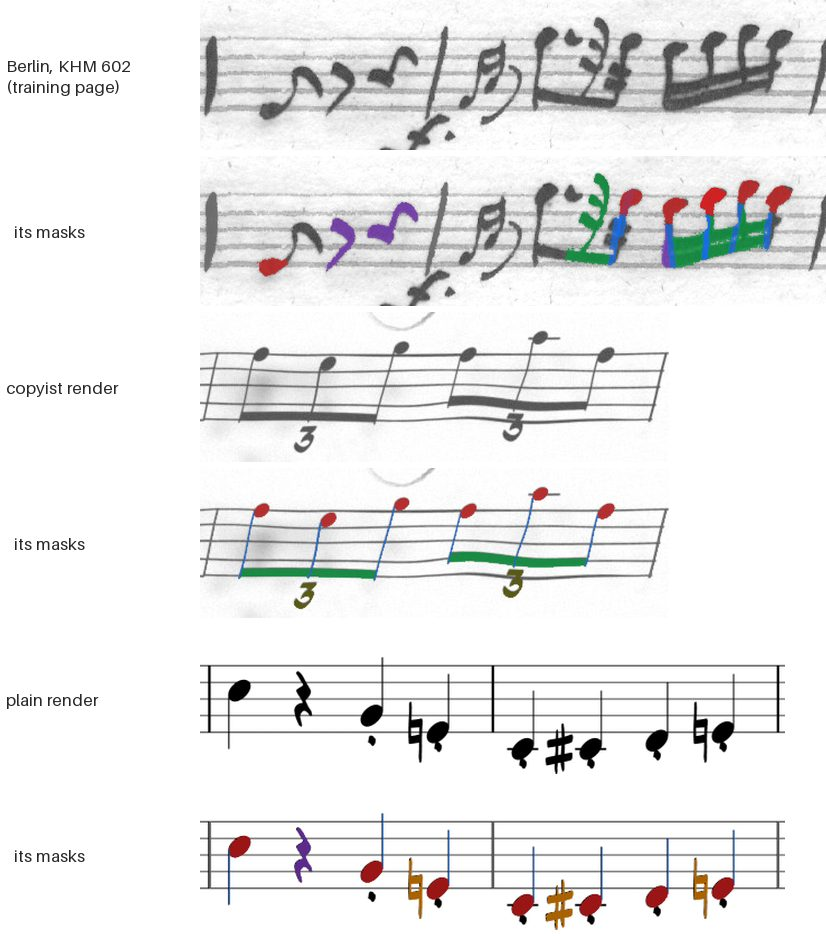
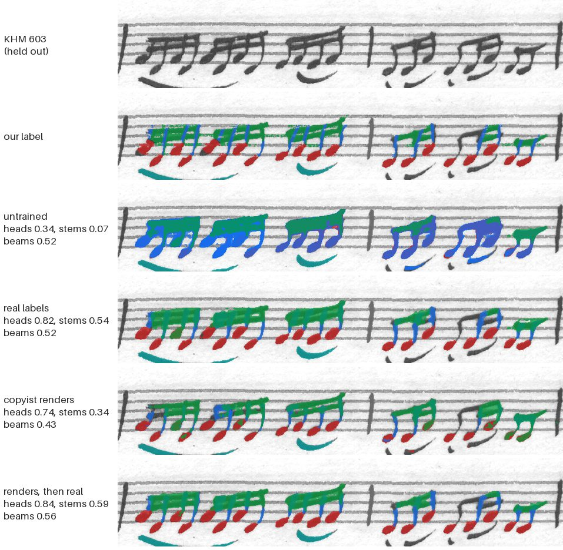
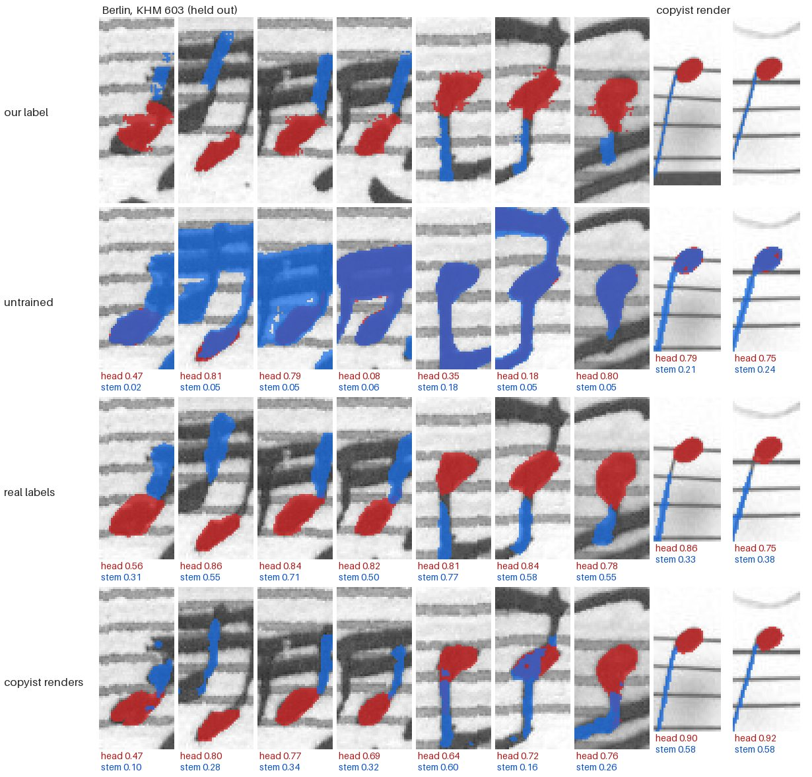
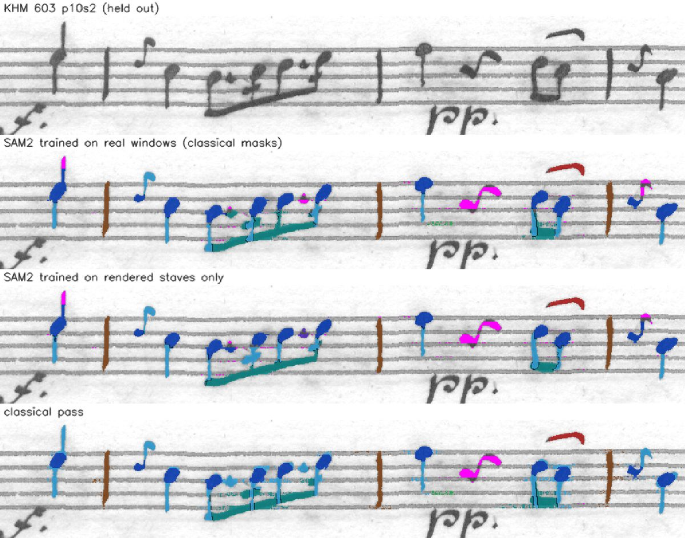

# Segment Anything on the Berlin hand: real labels help, renders don't (2026-10-19)

**Verdict: only our own real labels taught SAM2 the Berlin hand.** Trained
on the classical pass's masks from KHM 602, its mask decoder traced the
held-out KHM 603 pages at a mean IoU of 0.717, up from 0.620 untrained.
Heads rose from 0.55 to 0.85 and stems from 0.19 to 0.70. Every synthetic
source made it worse than untrained on Berlin: copyist renders (0.597),
plain renders (0.563) and Smashcima (0.577). Each was best on its own kind of
render. Renders first, then real labels, came out level with real labels
alone (0.706). Over whole staves the best SAM2 still leaves more ink
unclaimed than the classical pass: 6.9% against 2.8%. So the classical pass
stays the labeller for now. The yardstick is our own labels, which have a
house style, so these scores can't show where SAM2 is truer than they are.
Next: prompt each symbol on a small tile, and score on a hand-checked Berlin
test set.

## What we tried

The goal: tie each note a reader reads to its ink. The map already says
where each symbol is and what it is. What it lacks is each symbol's exact
extent. SAM2 takes a point or a box and returns a mask, so the map supplies
the prompts and SAM2 draws the masks.

### The model

- **SAM 2.1, hiera-small** (`facebook/sam2.1-hiera-small`, Apache 2.0).
  Segment Anything 3 was weighed and left for later. It is about 850M
  parameters, its weights are gated, and its licence is its own. SAM2 does
  points and boxes with a much smaller model.
- **Untrained, it cuts at the level of whole objects.** A point on a head
  returns the whole connected note: head, stem and often the beam. Figure 2
  shows this.
- **Fine-tuning:** the image encoder frozen; the mask decoder and prompt
  encoder trained (`sam_train.py`).
  - Loss: SAM's own, focal 20 : dice 1, against the label masks at the
    decoder's 256 × 256.
  - AdamW, learning rate 1e-4, weight decay 0.01, up to 24 prompts per step.
  - The best epoch is kept, judged by mean IoU on test2.
- **Runs:** on a Modal L4 GPU (`sam_modal.py`). The real-label runs took
  8 epochs: about 30 minutes on all real labels, 10 on the strict ones. The
  rendered runs took 4 epochs, 1.5 to 2 hours each.

### Windows and prompts

- **Windows** are overlapping pairs of bars (1-2, 2-3, 3-4 …), padded half a
  staff space. A slur or beam crossing a bar line then lies whole inside one
  window. This followed the bar lines in our labels, not fixed tiles.
- Each window is padded white to a square and scaled to 1024 × 1024. The
  music isn't stretched.
- **Prompts:** a point for each head and each stem; a box for every other
  symbol.

### How the real labels are made

Real labels come from the classical pass, not from a person:
1. **The map** (`align.py`) finds each note of a staff's label at its own
   height, inside its own bar, in playing order.
2. **The segmenter** (`segment.py`) lifts heads, stems and beams out of the
   ink. It sorts what's left against the label: accidentals, dots, flags,
   rests, slurs and marks.
3. **Curation** (`curate.py`) keeps each cut glyph that looks like its kind,
   moves it if it looks like another kind, and throws out the rest.
4. **`sam_data.py`** keeps only symbols the classical pass got right with
   some confidence:
   - filled heads with strong evidence, of plausible size;
   - stems over 1.8 spaces;
   - beams, and bar lines with their dots;
   - the cut glyphs curation kept or moved.

So a staff needn't be clean to give examples. A symbol needs to be right,
not its whole staff.

**The house style.** These masks have habits that clean masks don't share:
- A head label is the head's ink, grown back over what it covered, inside
  an oval round the head. So it often carries the root of its stem, or a
  ledger line.
- A stem label is a band about 5 px wide along the stem, with the head cut
  out.
- A beam label is the segmenter's piece of ink. It can run on along a staff
  line.

**Strict labels** (`sam_data.py --strict`) keep only symbols in bars the
classical pass got all but perfect:
- every note read with evidence of at least 0.6, on its own line or space,
  with a head of its own;
- every rest found;
- at most 2% of the bar's ink left unsorted.

That is 187 of KHM 602's 793 bars (24%).

**A fix along the way.** The first run (run1) trained on maps made before
the map's clef table was fixed. That table was one step off for every clef.
The fix raised heads at their label's height from 48% to 90%, across all 146
Berlin staves. Every run below uses the fixed maps.



*Figure 1. Training windows and their masks. Top: a KHM 602 window with its
classical labels. Only the symbols the classical pass got right are
labelled. Some heads carry their stem roots. Middle: a copyist render, with
an exact mask for every symbol. Bottom: a plain render. Heads red, stems
blue, beams green, accidentals orange, rests purple, tuplet numbers olive.
The two renders are from the test sets, drawn the same way as the training
renders, which were deleted after training.*

### The training sets

| run | trained on | windows | symbols | epochs | best epoch |
|---|---|---:|---:|---:|---:|
| run2 | real labels: 104 KHM 602 staves | 689 | 14,485 | 8 | 5 |
| run7 | strict labels: the same staves, good bars only | 302 | 3,268 | 8 | 3 |
| run3 | copyist renders: 992 quartet staves | 4,965 | | 4 | 4 |
| run4 | copyist renders, mixed fonts: 992 staves | 4,970 | | 4 | 3 |
| run5 | run3's decoder, then run2's real labels | 689 | 14,485 | 8 | 8 |
| run6 | plain renders: 991 quartet staves | 4,939 | | 4 | 1 |
| run8 | Smashcima: 1,091 staves | 5,262 | | 4 | 1 |

- **Copyist renders** (`sam_synth.py`): OpenScore quartet staves drawn as
  `copyist.py` draws the Berlin hand, in Petaluma. The copyist's own rests
  are pasted in, since no font has the hand's sideways-S quarter rest. A
  second drawing, with every symbol in its own flat colour and warped the same way,
  gives each symbol's exact mask.
- **Mixed fonts:** the same, with one font per staff (Petaluma twice,
  Leland, Gootville, Leipzig, Bravura). It scored the same as Petaluma
  alone. The copyist redraw replaces heads, stems and beams, so little of
  the font survives.
- **Plain renders** (`sam_synth.py --plain`): Verovio's five fonts as
  engraved, black on white. Only the staff size matches Berlin.
- **Smashcima** (`sam_smashcima.py`): see the
  [Smashcima report](../2026-10-19-smashcima/).

### The test sets

None of the runs trained on any of them.

| test set | what it is | windows | symbols |
|---|---|---:|---:|
| **test2** | 42 KHM 603 staves, labelled as for training | 215 | 4,329 |
| **test2s** | the good bars of 31 of those staves (strict labels) | 96 | 1,028 |
| **testR-copyist** | 40 copyist renders of held-out quartet music | 200 | 3,753 |
| **testR-plain** | 40 plain renders of held-out quartet music | 203 | 4,135 |

- The held-out music is the 42,560 of 44,609 quartet staves that no
  training set drew from (`heldout.txt`; see `docs/storage.md`).
- The score is IoU per symbol, averaged per kind, then averaged over the
  kinds with at least 5 symbols (`sam_eval.py`). Each kind counts alike, so
  heads and stems don't drown the rest.
- The IoU is taken at the decoder's 256 × 256 mask resolution.

## Results

Mean IoU over symbol kinds, from `eval1.json` and `eval2.json`:

| decoder | test2 | test2s | testR-copyist | testR-plain |
|---|---:|---:|---:|---:|
| untrained | 0.620 | 0.658 | 0.644 | 0.681 |
| real labels (run2) | **0.717** | 0.816 | 0.695 | 0.697 |
| strict labels (run7) | 0.702 | 0.802 | 0.676 | 0.686 |
| renders, then real (run5) | 0.706 | **0.819** | 0.721 | 0.712 |
| copyist renders (run3) | 0.597 | 0.700 | **0.782** | 0.738 |
| plain renders (run6) | 0.563 | 0.646 | 0.688 | **0.745** |
| Smashcima (run8) | 0.577 | 0.677 | 0.728 | 0.729 |

Run4 (mixed fonts) scored within 0.003 of run3 on every set: 0.600, 0.701,
0.782 and 0.738.

Row by row:
- **Untrained:** SAM2's own decoder. It scores highest on plain renders.
- **Real labels:** the best on Berlin. On renders it gains little over
  untrained (0.695 against 0.644, and 0.697 against 0.681).
- **Strict labels:** less than half the data, all of it cleaner. Slightly
  worse everywhere. Clean bars didn't make up for fewer examples.
- **Renders, then real:** level with real labels on Berlin (0.706 against
  0.717 on test2, 0.819 against 0.816 on test2s). Better than real labels
  on both rendered sets. The best all-round decoder.
- **Copyist renders:** below untrained on Berlin. The best on its own kind
  of render.
- **Plain renders:** the worst on Berlin. The best on its own kind.
- **Smashcima:** below untrained on Berlin. See its report.

### Per kind, on Berlin (test2)

| decoder | heads | stems | beams | bar lines | rests | slurs | flags | trills | dots |
|---|---:|---:|---:|---:|---:|---:|---:|---:|---:|
| *symbols* | *1,731* | *1,749* | *330* | *307* | *68* | *74* | *24* | *16* | *22* |
| untrained | 0.55 | 0.19 | 0.52 | 0.76 | 0.82 | 0.81 | 0.61 | 0.67 | 0.47 |
| real labels | 0.85 | 0.70 | 0.62 | 0.80 | 0.85 | 0.85 | 0.61 | 0.76 | 0.27 |
| strict labels | 0.83 | 0.65 | 0.59 | 0.79 | 0.84 | 0.84 | 0.61 | 0.73 | 0.31 |
| renders, then real | 0.85 | 0.70 | 0.63 | 0.79 | 0.84 | 0.84 | 0.60 | 0.74 | 0.24 |
| copyist renders | 0.70 | 0.41 | 0.48 | 0.68 | 0.82 | 0.77 | 0.53 | 0.69 | 0.12 |
| plain renders | 0.65 | 0.36 | 0.45 | 0.69 | 0.72 | 0.72 | 0.54 | 0.66 | 0.12 |
| Smashcima | 0.57 | 0.45 | 0.46 | 0.71 | 0.77 | 0.76 | 0.58 | 0.68 | 0.09 |

Accidentals (5 symbols) also count in the mean. They score 0.80 untrained
and 0.86 for real labels.

- **Heads and stems are where training pays.** Real labels lift heads by
  0.29 and stems by 0.51.
- **Bar lines, rests and slurs** are already good untrained (0.76 to 0.82),
  since a box prompt says nearly everything. Training adds 0.03 to 0.04.
- **Beams** stay at 0.62 at best.
- **Dots get worse with training:** 0.47 untrained, 0.27 with real labels.
  There are only 22, so this is noisy. Real labels hold very few dots to
  learn from (63 of 14,485 symbols).



*Figure 2. One held-out KHM 603 window (p17s5, bars 4-5), prompted the same
way for each decoder. Colours as in Figure 1; slurs teal. Untrained, a point
on a head or a stem returns the whole note. Trained on real labels, it cuts
heads, stems and beams apart. Its beams fill each group as one block, gaps
and staff lines included; our label's beams also spill onto the staff
lines. The scores beside each row are for this window only, at the window's
own resolution, so they differ a little from the table's.*

### Stems are held back by the mask's resolution

The decoder returns a 256 × 256 mask for the whole square window. On test2
the median window is 612 × 147 px, so one mask cell covers about 2.4 px of
the page.

- **Berlin's stem labels** are about 5 px wide (median), two cells. Real
  labels reach 0.70.
- **Rendered stems** are 1 to 1.4 px wide, less than one cell. On copyist
  renders no decoder passes 0.47 on stems. On plain renders none reaches
  0.23, though heads reach 0.92.

So a stem is near the limit of what one mask over a two-bar window can
draw.



*Figure 3. Notes close up: each head (red) and its stem (blue), as our label
has them and as three decoders trace them, with each one's IoU against the
label. Where a head and a stem mask overlap, the stem's blue is drawn on
top. Left, seven Berlin notes from two held-out windows: our heads carry
their stem roots, and the model trained on real labels draws them the same
way. Right, two copyist-render notes, with hairline stems.*

## Over whole staves

`sam_apply.py` prompts every symbol of a mapped staff:
- a point for each head and stem the map has;
- a box for each grace head and each dotted note's dot;
- a box for each symbol the segmenter sorted.

Each symbol is predicted in the window where it sits most centrally. The
score is the share of ink no mask claims. Specks, staff-line remnants, the
staff's opening and the margins aren't counted. Here each mask is grown over
the ink it touches, up to one staff space, off the staff lines.

On four held-out KHM 603 staves (p10s2, p5s4, p11s2, p5s5):

| | unclaimed ink |
|---|---:|
| real labels (run2) | 6.9% |
| renders, then real (run5) | 7.2% |
| copyist renders (run3) | 7.8% |
| classical pass | 2.8% |



*Figure 4. KHM 603 p10s2, held out, as `sam_apply.py` draws it: heads dark
blue, stems light blue, beams teal, slurs red, bar lines brown, unclaimed
ink magenta. Rows: the page; SAM2 trained on real labels; SAM2 trained on
copyist renders only; the classical pass. The copyist's sideways-S quarter
rest (bar 3) is magenta in every row: nothing prompts it yet.*

What's left unclaimed is mostly what nothing prompts: the clef, key and time
signature, dynamics, and the sideways-S rest. There are also stem tops and
specks where staff lines were lifted.

## What it means

- **Only real labels from our own pages help on the real hand.** Each
  synthetic source taught SAM2 symbols in general: each scored best on its
  own kind of render. None carried over to Berlin. The gap runs both ways:
  real-label decoders lose about as much on renders.
- **Part of the gap is the yardstick.** test2 is scored against the
  classical pass's masks, house style and all. A decoder trained on them
  learns to draw stem roots into heads (Figure 3) and to fill beam groups
  as blocks (Figure 2). A decoder that draws clean shapes loses overlap
  for it. The [Smashcima report](../2026-10-19-smashcima/) shows the same.
- **Labels needn't be clean bar by bar.** Taking only near-perfect bars
  kept a quarter of the data and scored slightly lower.
- **Stems look limited by resolution, not data.** Even with exact masks
  and about 5,000 rendered windows, hairline stems stay below 0.5.
- **For tying notes to ink, SAM2 doesn't yet beat the classical pass.** On
  whole staves the classical pass leaves less than half as much ink
  unclaimed.

### Caveats

- **The best epoch was chosen on test2.** So test2 slightly flatters every
  trained decoder. The other three test sets played no part in training.
- **Small kinds are noisy:** dots (22), flags (24), trills (16) and
  accidentals (5) on test2.
- **The rendered test sets favour their own generator.** testR-copyist is
  drawn as run3's training staves were; testR-plain as run6's.
- **Unclaimed ink measures coverage, not correctness.** Growing a mask
  hands touching ink to it, right or wrong.

## Cost

The eight runs' epochs took 32,056 s of L4 time in all, about 8.9 GPU-hours
(from the logs). At the $0.80 an hour noted for the L4 on 16 October, that's
about $7. Not counted: one Smashcima run lost when the Mac's disk filled,
one relaunch of run3, and scoring (about 5 minutes per decoder on Modal).

## What's next

1. **Prompt each symbol on its own small tile** rather than a two-bar
   window. That raises the mask's resolution four to eight times. It should
   lift stems, dots and hooks for every decoder.
2. **A hand-checked Berlin test set:** 3–4 staves with masks as a person
   would draw them, including dots, rests, grace notes and hooks. It would
   show how much of the gap is our labels' house style rather than the
   model. It would also re-score the rendered training sets fairly.
3. **Prompt what nothing prompts yet:** the sideways-S quarter rest, the
   clef, key and time signature.

## How to reproduce

Data lives in `~/Data/manuscript-labeler/experiments/` (it can be rebuilt;
see [`docs/storage.md`](../../docs/storage.md)). Below, `SAM` is
`.../experiments/sam`, `MAPS` is `.../experiments/maps/berlin2`, and `k602.txt` and `k603.txt` (in `SAM`)
list the staves.

```sh
# 1. the classical maps, segments and curated glyphs (per staff; KEY like D-B_KHM-602/p10s4)
uv run experiments/synth/align.py KEY [...] --out MAPS
uv run experiments/synth/segment.py KEY [...] --maps MAPS --glyphs MAPS/glyphs
uv run experiments/synth/curate.py MAPS/glyphs/berlin

# 2. real windows (add --strict for train2s and test2s)
uv run experiments/synth/sam_data.py --maps MAPS --glyphs MAPS/glyphs/berlin --out SAM/train2 $(cat SAM/k602.txt)
uv run experiments/synth/sam_data.py --maps MAPS --glyphs MAPS/glyphs/berlin --out SAM/test2 $(cat SAM/k603.txt)

# 3. rendered windows: 250 staves per seed, seeds 0, 100000, 200000, 300000 (plain: each seed + 7)
uv run experiments/synth/sam_synth.py osq-all.txt --glyphs MAPS/glyphs/berlin --hand berlin --n 250 --seed 0 --out SAM/synth1
uv run experiments/synth/sam_synth.py osq-all.txt --glyphs MAPS/glyphs/berlin --plain \
    --fonts Leipzig,Bravura,Gootville,Leland,Petaluma --n 250 --seed 7 --out SAM/plain1
# the rendered test sets, from the held-out music
uv run experiments/synth/sam_synth.py SAM/heldout.txt --glyphs MAPS/glyphs/berlin --hand berlin \
    --fonts Petaluma,Petaluma,Leland,Gootville,Leipzig,Bravura --n 40 --seed 910000 --out SAM/testR-copyist
uv run experiments/synth/sam_synth.py SAM/heldout.txt --glyphs MAPS/glyphs/berlin --plain \
    --fonts Leipzig,Bravura,Gootville,Leland,Petaluma --n 40 --seed 900000 --out SAM/testR-plain

# 4. train on Modal (an L4; `uv run --with modal modal run ...` if modal isn't installed);
#    run5 adds --init SAM/run3-synth/decoder.pt
modal run experiments/synth/sam_modal.py::main --train-dir SAM/train2 --test-dir SAM/test2 --out SAM/run2-real --epochs 8
modal run experiments/synth/sam_modal.py::main --train-dir SAM/synth1 --test-dir SAM/test2 --out SAM/run3-synth --epochs 4

# 5. score every decoder on the four test sets (or locally: uv run experiments/synth/sam_eval.py ...)
modal run experiments/synth/sam_modal.py::evaluate --tests SAM/test2,SAM/test2s,SAM/testR-copyist,SAM/testR-plain \
    --decoders untrained,SAM/run2-real/decoder.pt,SAM/run3-synth/decoder.pt --out SAM/eval1.json

# 6. whole staves, and unclaimed ink
uv run experiments/synth/sam_apply.py D-B_KHM-603/p10s2 D-B_KHM-603/p5s4 D-B_KHM-603/p11s2 D-B_KHM-603/p5s5 \
    --maps MAPS --decoder SAM/run2-real/decoder.pt --grow 1 --mask-colours --sheet run2-real-sheet.png

# 7. this report's figures
uv run reports/2026-10-19-segment-anything/figures.py SAM
```

`osq-all.txt` and `heldout.txt` still list each staff under the old
scratchpad (`.../scratchpad/synth/osq-lmx/`). Point them at
`~/Data/manuscript-labeler/experiments/synth/osq-lmx/` first, keeping the
order: the renderers' shuffles depend on it.

`sam_try.py` shows the untrained model on a few windows. The held-out music
list is rebuilt as `docs/storage.md` says.

## Where things are

- **Code:** in `experiments/synth/`:
  - [`sam_data.py`](../../experiments/synth/sam_data.py): real windows;
  - [`sam_synth.py`](../../experiments/synth/sam_synth.py): rendered windows;
  - [`sam_smashcima.py`](../../experiments/synth/sam_smashcima.py): Smashcima windows;
  - [`sam_train.py`](../../experiments/synth/sam_train.py): fine-tuning;
  - [`sam_modal.py`](../../experiments/synth/sam_modal.py): training and scoring on Modal;
  - [`sam_eval.py`](../../experiments/synth/sam_eval.py): scoring;
  - [`sam_apply.py`](../../experiments/synth/sam_apply.py): whole staves;
  - [`sam_try.py`](../../experiments/synth/sam_try.py): the untrained look;
  - [`align.py`](../../experiments/synth/align.py), [`segment.py`](../../experiments/synth/segment.py), [`curate.py`](../../experiments/synth/curate.py): the classical pass.
- **Scores:** `eval1.json` (every decoder but Smashcima) and `eval2.json`
  (Smashcima), with each run's `log.json` and `stdout.txt`, in
  `~/Data/manuscript-labeler/experiments/sam/`.
- **Decoders:** each run's `decoder.pt` there, and only there. A bug in
  `sam_modal.py` (fixed after these runs) saved each run's backup on the
  `copyist-sam-runs` volume under a test file's name, so each overwrote the
  last; what the volume holds is one run's files under an odd path.
- **Test windows:** test2, test2s, testR-copyist and testR-plain, there
  too.
- **Training windows:** train2, train2s and plain1 are kept. synth1, synth2
  and smash1 were deleted after training; step 3 rebuilds them.
- **The figures:** [`figures.py`](figures.py). Figure 4 is
  `~/Data/manuscript-labeler/experiments/sam/real-vs-synth.png`, cut from
  `sam_apply.py`'s sheets.
- **Related:** the [Smashcima report](../2026-10-19-smashcima/);
  [`experiments/synth/README.md`](../../experiments/synth/README.md) for how copyist staves are drawn.
