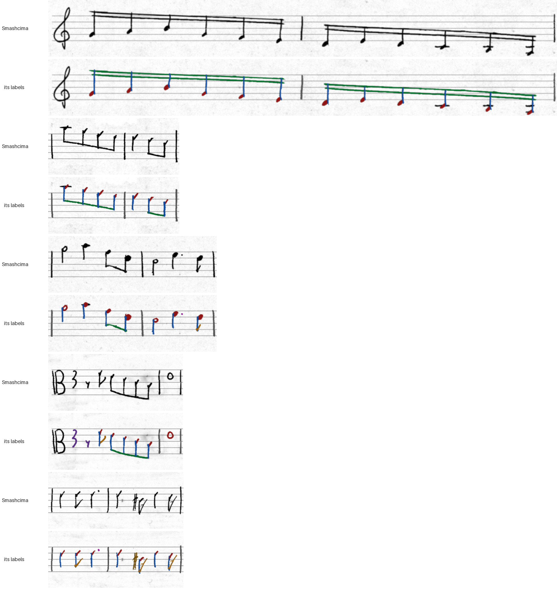
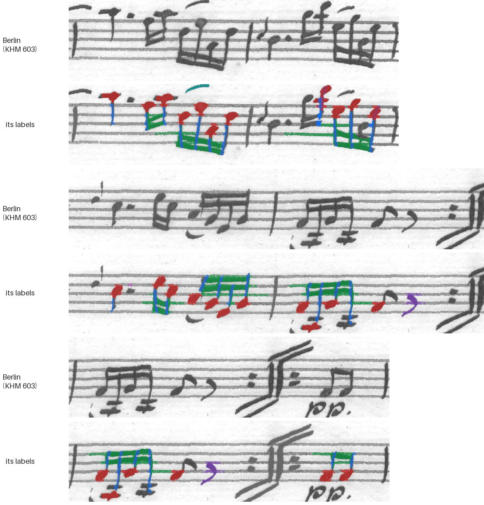
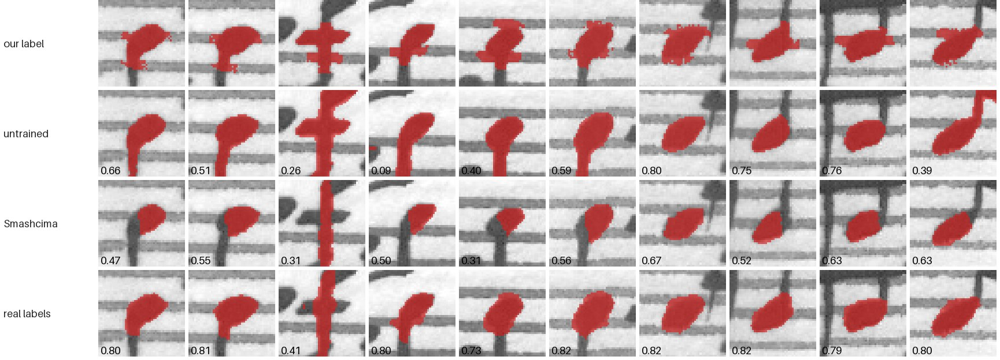
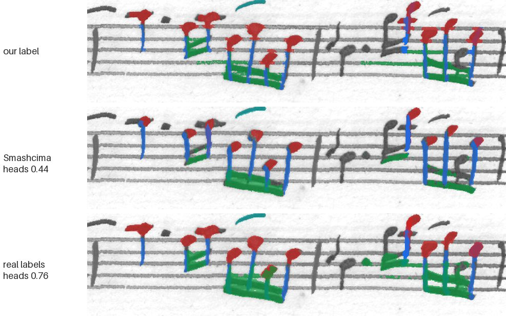
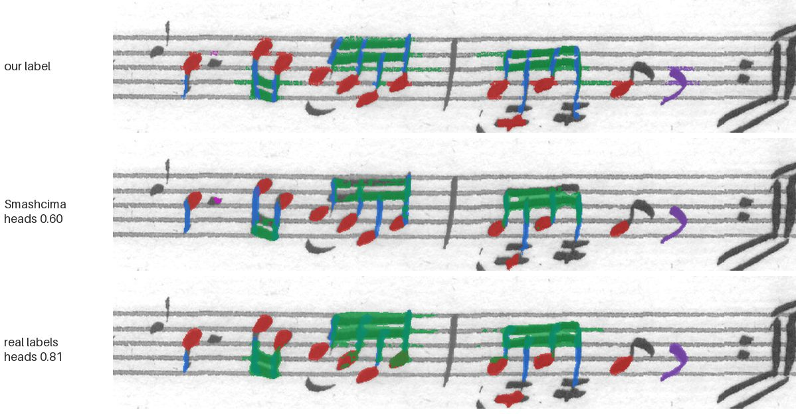

# Smashcima for Segment Anything: tried, dropped (2026-10-19)

**Verdict: don't retry with other settings.** Trained on Smashcima's
handwritten staves, Segment Anything traced Berlin's symbols *worse* than
it does untrained (0.577 against 0.620). It was among the best on rendered
staves, so it learned symbols in general, just not our copyist. The reasons
are in what Smashcima draws, not in how it was run.

This is one run of a larger experiment. The others, and how each decoder
was trained and tested, are in
[Segment Anything on the Berlin hand](../2026-10-19-segment-anything/).

## What we tried

- **The staves:** Smashcima 1.1.2 (Mayer et al.), with MUSCIMA++'s symbols.
  Each staff is written out by one of MUSCIMA++'s 50 writers, and each
  symbol's mask is its own ink, so the masks are exact.
  - The music: the same quartet staves as the copyist renders
    (`synth/osq-all.txt`). 1,091 staves gave 5,262 windows of two bars and
    about 34,000 heads.
  - Staff space: Berlin's size.
  - The generator: `experiments/synth/sam_smashcima.py`.
- **The training:** as for every other run. That means SAM 2.1
  (hiera-small), with the image encoder frozen and the mask decoder and
  prompt encoder fine-tuned. It ran for 4 epochs on Modal.
- **The scoring:** mean IoU over symbol kinds (those with at least 5
  symbols), on four test sets none of the runs trained on:
  - **test2:** the KHM 603 test pages;
  - **test2s:** their near-perfect bars;
  - two sets of rendered staves from held-out music, one in the copyist's
    hand and one in plain fonts.

| model | test2 | test2s | rendered, copyist | rendered, plain |
|---|---:|---:|---:|---:|
| untrained | 0.620 | 0.658 | 0.644 | 0.681 |
| real labels (KHM 602) | **0.717** | 0.816 | 0.695 | 0.697 |
| copyist renders + real | 0.706 | **0.819** | 0.721 | 0.712 |
| copyist renders | 0.597 | 0.700 | **0.782** | 0.738 |
| plain fonts | 0.563 | 0.646 | 0.688 | **0.745** |
| **Smashcima** | **0.577** | 0.677 | 0.728 | 0.729 |

Its best epoch was the first. Later epochs got worse on Berlin: heads fell
from 0.58 to 0.54 and beams from 0.46 to 0.36. So more training only fits
Smashcima's hand more closely.

## Why it didn't work

### 1. A modern pen, not a quill

Each Smashcima pair below is a staff, then the same staff with its labels:
heads red, stems blue, beams green, accidentals and flags orange, rests
purple.

The strokes are thin and even. Many writers draw a head as a dash or a tick
much smaller than a staff space. Notes are spread wide, and beams are a
single line.

Berlin, the same way:

Here the ink is heavy and grey. Heads fill a space and lean. Sixteenths are
crammed under stacked beams, with slurs, grace notes and ledger lines among
them. A model taught on the first expects heads that are smaller and lighter
than Berlin's.

### 2. Simplified music

Smashcima 1.1.2 can't draw slurs, ties, tuplets, trills, grace notes, or key
and time signatures. Its loader has these as TODOs. Leaving them out leaves
mostly plain runs of eighths. So the model rarely sees what makes Berlin
hard: stacked beams, slurs over notes, crowded chords. The same gap is why
the MuSViT reader's synthetic staves were drawn on Verovio instead (see "Why
not Smashcima" in `experiments/synth/README.md`).

### 3. Our labels have a house style, and Smashcima's don't share it

Berlin's labels come from the classical pass. It cuts a head out of the ink,
so a head label often carries the top of its stem or a ledger line. A beam
label often runs on along a staff line. Smashcima's heads stop where the
stem starts.

Ten Berlin heads close up, with each model's overlap with our label:

- The Smashcima model draws the clean oval, and loses overlap for it.
- The model trained on real labels reaches 0.8 partly by drawing the stem
  stub too.

The same holds for whole staves. Below, each pair of bars shows our labels,
then the Smashcima model, then the real-labels model.

In the second figure, the real-labels model runs its beams on along the
staff lines, just as our labels do. The Smashcima model's beams stop at the
stems. Its heads are smaller than the copyist's.

So part of the gap is how we label, not what the model sees. That holds for
the rendered training staves too.

## What wouldn't change the verdict

- **More epochs.** Its best was the first.
- **More staves, or other writers.** It already drew from all 50 writers,
  over 1,100 staves.
- **Mixing it with real labels.** Not run for Smashcima. But copyist renders
  mixed with real labels scored 0.706 on Berlin, against 0.717 for real
  labels alone. Synthetic staves added nothing on the real hand.

## What would

- **A hand-checked Berlin test set,** with masks as a person would draw them.
  It would show how much of reason 3 is our labels rather than the model.
  This would also re-score the rendered training staves.
- **A Smashcima that draws the missing symbols, in a quill-like hand.** As
  of 1.1.2, it does neither.

## Where things are

- **The generator:** `experiments/synth/sam_smashcima.py`. It points MUSCIMA++ at its new
  address, since the one in 1.1.2 is dead.
- **The figures:** `figures.py`, run over the training windows, the test
  pages and the two models.
- **The trained model:** the `copyist-sam-runs` volume on Modal, under
  `run8-smash/`.
- **The training windows:** these were in a temporary scratchpad and are
  gone. The generator rebuilds them (`--n 278`, seeds 0, 100000, 200000 and
  300000).
