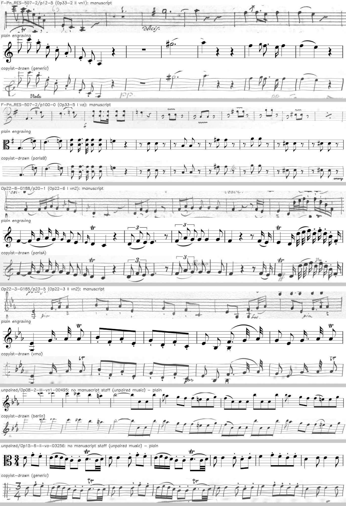

# Synthetic staves first, then real (2026-10-19)

**Verdict: the order matters.** Training the MuSViT reader on synthetic
staves first, then on real ones, read 278–280 of the clean test's 347 bars
exact. The same recipe without the synthetic stage read 266. Two runs did
this with different music, and both clear zero:
- SF2: +12 bars (95% interval +1 to +23);
- PF2-copyist: +14 bars (+2 to +26).

Mixing synthetic staves into the real stage instead (S1) gained nothing
(−4, −15 to +7). Which music was drawn mattered less. Drawing it in a
copyist's hand rather than plain print helped by 6 bars, inside the noise.
Each run is one seed.

These results sat in run summaries for a day before anyone wrote them up.
The Copyist Staves page and the MuSViT brief still say synthetic staves gave
no gain on the clean test; that was S1, the mixed run.

## What we tried

Every run starts from E2-tf8, the reader after stage 1 (public staves). The
real stage is D1's recipe on dataL2: Op. 48's training movements plus the
re-paired Philhar staves, with the practice exam for early stopping. The
runs differ only in what comes between.

- **S0:** nothing between. The baseline.
- **S1:** no separate stage. Half of each real pass is drawn afresh from
  dataS (10,762 synthetic staves).
- **SF1, then SF2:** a synthetic stage on dataS3 alone (10,790 staves: our
  copyists' hands, density matched per hand, their own clefs, music from the
  OpenScore quartets and our own training music). Then the real stage from SF1.
- **PF1, then PF2:** SF's recipe exactly, with only the synthetic staves
  changed: Philhar's own music (8,039 lines from 54 quartets, no Op. 48),
  10,787 rows drawn two ways.
  - **copyist:** in our copyists' hands, as `copyist.py` draws them;
  - **plain:** the same staves engraved in a printed font (Leipzig or
    Bravura), nothing redrawn.

*The Philhar sets. Each group shows a manuscript staff (where there is
one), the same music engraved plain, and drawn in a copyist's hand. The
last two groups are unpaired music, with no manuscript staff.*

## Results

The clean test is KHM 603 movement I, 347 bars, which no run trains on. The
practice exam is symbol errors on held-out movements (lower is better),
used to pick each run's best pass.

| run | synthetic stage | practice exam | bars exact | rhythm right | pitch right |
|---|---|---:|---:|---:|---:|
| S0 | none | 0.181 | 266 (77%) | 298 | 296 |
| S1 | mixed into the real stage | 0.169 | 262 (76%) | 287 | 296 |
| SF1 | dataS3 only, no real stage | 0.228 | 222 (64%) | 267 | 251 |
| **SF2** | dataS3, then real | 0.170 | **278 (80%)** | 303 | 307 |
| PF1-copyist | Philhar, copyist-drawn, only | 0.216 | 229 (66%) | 266 | 265 |
| **PF2-copyist** | Philhar, copyist-drawn, then real | 0.169 | **280 (81%)** | 296 | 309 |
| PF1-plain | Philhar, plain, only | 0.287 | 218 (63%) | 254 | 249 |
| PF2-plain | Philhar, plain, then real | 0.178 | 274 (79%) | 304 | 301 |

For reference: musvit-D1 reads 263 (D1's recipe on dataL). musvit-D3, the
released reader, reads 270. D3 trained on more real staves than any run
here: everything but the clean test.

**Paired bootstrap over the 347 bars, 95%:**

| comparison | bars | interval | what it tests |
|---|---:|---:|---|
| SF2 against S0 | +12 | +1 to +23 | a synthetic stage first |
| PF2-copyist against S0 | +14 | +2 to +26 | the same, other music |
| PF2-plain against S0 | +8 | −4 to +19 | the same, printed |
| S1 against S0 | −4 | −15 to +7 | synthetic staves mixed in |
| PF2-copyist against SF2 | +2 | −9 to +14 | Philhar's music against OpenScore's |
| PF2-plain against PF2-copyist | −6 | −17 to +5 | plain print against a copyist's hand |
| PF1-plain against PF1-copyist | −11 | −27 to +4 | the same, synthetic stage only |

SF2 against S0 was computed on 2026-10-20 from the committed results, with
`philhar_first.py`'s bootstrap; the same code reproduces its other rows.
The rest come from `drivers/philhar-first-summary.md`.

## What it means

- **A synthetic stage of its own helps; mixing doesn't.** The reader seems
  to need the synthetic staves as a stage it then moves on from, not as a
  share of its real diet.
- **The hand probably helps a little.** Copyist-drawn led plain at both
  stages, and plain transferred worse on the practice exam (0.287 against
  0.216). Neither interval clears zero.
- **The music doesn't matter much.** Philhar's music matched OpenScore's.
- **Against D3:** D3's 270 comes from more real data. A crowned run with a
  synthetic stage first is the obvious next step, and untested.

## Caveats

- **One seed each.** The bootstrap covers which bars were sampled, not
  run-to-run noise.
- **The clean test has been consulted for many runs.** One interval just
  clearing zero would be weak evidence. Two runs with different music both
  clearing it is better, but not proof.
- **The practice exam leaked slightly into the copyist-drawn staves.**
  Code review on 2026-10-20 found that `copyist.py` takes its paper and its
  margin ink from every dataL2 staff, the practice exam's included (KHM 602
  II, Op. 48/5 I). The practice exam picked each run's best pass, so the
  copyist-drawn runs' picks may be slightly flattered. The clean test isn't
  in dataL2, so the bars-exact numbers are unaffected.
- **Not scored on the unseen hands** (Madrid, Op. 32): neither S0 nor SF2
  was scored there, so there was nothing to compare against.
- **PF1-plain stopped at pass 2** under the same patience rule, so it
  trained on fewer passes.

## Next

1. A crowned run with the synthetic stage: D3's recipe, started from SF1
   or PF1-copyist.
2. Madrid and Op. 32 scores for SF2 and PF2.
3. A second seed of SF2 and S0.

## Cost

- **Machine:** Modal L40S GPUs (`modal_app.py --gpu L40S`). The synthetic
  staves were drawn, and the clean test read, on the Mac (a Mac mini, M1,
  16 GB).
- **Billed: $5.29** for the six runs here, SF1, SF2 and PF1 and PF2 in both
  hands, one Modal app each (measured, `modal billing report`): L40S $5.13
  (about 2.6 GPU-hours), memory and CPU $0.16.
- **Training time:** 2.2 GPU-hours of passes (measured, the run logs). A
  synthetic pass took about 3 minutes, so a synthetic stage 16–30 minutes;
  a real stage took 14–23 minutes.
- **Wall time:** SF1 then SF2, about 70 minutes (2026-10-18, 10 to 11 pm).
  The four PF runs, two chains at once, about 100 minutes (2026-10-19, 4:40
  to 6:20 am). Measured roughly, from the drivers' and summaries' file
  times.
- **The baseline S0** ($0.75) was run for the Copyist Staves page and is
  counted there.
- **Drawing dataS3:** about 10 minutes on the Mac, six processes (measured,
  `gen3.log`'s times). The Philhar sets weren't timed.

## Reproduce

- **Data:** `experiments/synth/gen.py` (dataS3);
  `experiments/synth/philhar_lines.py` and `philhar_render.py` (the
  Philhar sets, dataPc and dataPp).
- **Runs:** `experiments/musvit/drivers/synth_test.py` (S0, S1),
  `synth_first.py` (SF1, SF2), `philhar_first.py` (PF1, PF2). They launch
  `modal run` on `experiments/musvit/modal_app.py`; read each before
  rerunning (see `drivers/README.md`).
- **Where things are:**
  - readings and scores: `experiments/zeus/answers/` and `results/`,
    `D-B_KHM-603*-musvit-<run>*`;
  - summaries: `experiments/musvit/drivers/*-summary.md`;
  - models: Modal volume `musvit`, `runs/<run>`;
  - staves: Modal volume `musvit-staves` (`/dataS`, `/dataS3`, `/dataPc`,
    `/dataPp`).
