# Boccherini 6k: a tie; beams learned, bar counts lost

2026-10-22. musvit-D4's chain with its last stage on the re-detected,
re-paired sets: **Public 9k → Drawn 15k → Boccherini 6k** (run D5-B6k),
against D4's Public 9k → Drawn 11k → Boccherini 3k.

**Verdict: a tie with D4, made of trades.** (Corrected the same day: the
first version read the held-out score as a much better reader; see
Correction below.)
- **The clean test** (KHM 603 I, Berlin): 277 of 347 bars exact, the
  same as D4 (+0; 13 bars better, 13 worse; 95% interval −10 to +10).
- **A held-out manuscript in a new hand** (Dresden Mus.3403, M. Haydn's
  MH 411 quintet, 353 staves its pairing labelled, left out of training):
  symbol errors 16.2% → 10.3%, staves exact 23 → 48; but that gain is
  beams (D4 reads this copyist's beams as slurs). In notes and rhythm,
  scored as the clean test scores them, D4 reads it better (84% of bars
  exact against 76%), all of it staves the new reader miscounts (28
  against 8); where both count the bars right, 86% each.
- **Flags for the edition** (Op48-2 I, floor 3): the same 94 of 107
  errors caught; 17 false flags against D4's 14.
- **Cost:** $0.93 on Modal (L40S $0.82, CPU $0.10); 24 passes of 46–47 s.

Not released: in notes and rhythm it is no better anywhere, and it
miscounts bars on a new hand more often than D4.

## The stages

| stage | what it trains on | staves |
|---|---|--:|
| Public 9k | MusiCorpus's Dolores and OmniOMR (E2-h96) | 8,765 |
| Drawn 15k | drawn staves in our copyists' hands, with the clef-change ones (dataS3, dataS4; SF1-h96-clef, from the clef run) | 14,760 |
| **Boccherini 6k** | Op. 48's training and practice-exam movements (dataL2: 595), Philhar's quartets with the Madrid copies (dataM5: 4,371), Philhar's other works but Dresden (dataW4: 853), the print's agreed bars (dataP4: 21), G. 213's copies (dataG213-4: 435) | **6,275** |

Boccherini 3k was dataL2, dataM and dataT (3,411). The new sets come from
the [redetection](../2026-10-22-redetection/),
[bars that cross a line](../2026-10-22-split-bars/) and
[bar lines the reading missed](../2026-10-22-missed-bar-lines/); the Madrid
copies, dataT before, are in dataM5. Campioni's Op. 7 (Berlin, 338
staves) is in too, so the stage isn't Boccherini's alone. No Op. 48 source
is in the new sets, so the clean test's music isn't either; every token
in them is in Drawn 15k's vocabulary.

The recipe is D4's Boccherini stage: 24 passes of a 30-pass schedule, lr
1e-4, LoRA rank 64 on attention and MLP, bfloat16. New: the batches built
by 4 worker processes on 5 reserved cores (proto.py --workers): a pass
took 46–47 s for 6,275 staves, as D4's took 47 s for 3,411, about twice
the staves a second.

## Results

**Clean test** (KHM 603 I; read on the Mac, `-mps`):

| reader | bars exact | rhythm | pitch | clef errors |
|---|--:|--:|--:|--:|
| musvit-D4 (Drawn 11k, Boccherini 3k) | 277 | 300 | 311 | 4 |
| with Drawn 15k (clef run) | 277 | 297 | 316 | 1 |
| **Boccherini 6k** | **277** | 296 | 316 | 1 |

By part, bars exact (D4, clef run, Boccherini 6k): violin I 63, 58, 60;
violin II 62, 62, 58; viola 74, 80, 79; cello 78, 77, 80. Violin II's
duration errors rose (47, 33, 64).

**Held out, Dresden Mus.3403** (proto.py --epochs 0, the 353 staves as
dataset.py labelled them from the pairing, checked bar for bar against
the encoding):

| reader | symbol errors | staves exact |
|---|--:|--:|
| musvit-D4 | 16.2% | 23 |
| with Drawn 15k (clef run) | 18.2% | 14 |
| **Boccherini 6k** | **10.3%** | **48** |

**Flags for the edition** (the edition's flag_test.py on Op48-2 I, with
the reader from a local test build, as in the clef run):

| floor | reader | flagged | wrong | false | caught |
|---:|---|--:|--:|--:|---|
| 2 | Boccherini 6k | 112 | 95 | 17 | 95 of 107 |
| 2 | musvit-D4 | 110 | 94 | 16 | 94 of 107 |
| **3** | **Boccherini 6k** | **111** | **94** | **17** | **94 of 107** |
| **3** | **musvit-D4** | **108** | **94** | **14** | **94 of 107** |
| 6 | Boccherini 6k | 102 | 93 | 9 | 93 of 107 |
| 6 | musvit-D4 | 102 | 93 | 9 | 93 of 107 |

## Correction: what the held-out gain was made of

The held-out score counts every token of a staff: beams, slurs and
articulations as well as notes. Broken down (errors over the 353 staves,
D4 then Boccherini 6k):

| kind | D4 | Boccherini 6k |
|---|--:|--:|
| beams | 4,240 | 1,166 |
| pitches | 917 | 1,114 |
| durations | 898 | 958 |
| slurs | 758 | 1,104 |
| articulations | 518 | 729 |
| tuplets, voices | 234 | 520 (most of it sextuplets read where there are none) |
| staves with a bar too many or too few | 8 | 28 |

- **Beams are real.** Dresden p49-3, sixteenths in beamed fours as the
  label has them: D4 wrote no beam, a slur over each group; Boccherini 6k
  wrote the beams.
- **In notes and rhythm** (pitches, rests, durations, dots, chords,
  graces, tuplets, as the clean test compares bars): D4 84% of bars
  exact, Boccherini 6k 76%. On the 320 staves both count right, 86% each
  (Boccherini 6k with fewer rhythm errors, 207 against 240, and more in
  pitch or chord, 168 against 128). The gap is the miscounted staves:
  354 bars on Boccherini 6k's against 84 on D4's.
- **Slurs and staccatos**: both readers write about half again as many
  slurs as the labels (663) and about half their staccatos (680). Some of
  it is the labels: they come from Philhar's encoding, not the copyist's
  pen (p19-7: a slur on two eighths the image doesn't show). How much is
  not yet measured.
- So Dresden isn't much harder than the clean test in notes and rhythm
  (86% against 80%); the 48 staves exact is the all-token score, which
  no reader can win while the labels' markings aren't the copyist's.

**The clean test's trades.** Boccherini 6k gained 13 bars D4 missed (7 in
the viola; D4's errors there: 11 notes missed, 9 pitches, 9 durations) and
lost 13 (6 in violin II, 4 in violin I; 29 of its 40 errors there are
durations: 32nds read as 16ths, a 16th as an eighth, double stops
regrouped).

## The bars traded, with images

The clean test's bars one reader got exactly and the other didn't (crops from the editor's bar boxes;
readings as compare.py writes them: pitch:value, g a grace, r a rest, <> a chord; a triplet's 3 isn't
shown). `bars.json` holds them.

### Bars Boccherini 6k got and D4 missed (13)

Mostly notes D4 left out and pitches, 7 in the viola.

**va 28** (pitch)

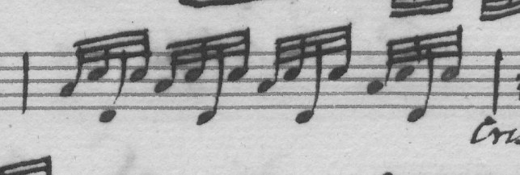

```
score  B3:32nd D4:32nd E3:32nd D4:32nd B3:32nd D4:32nd E3:32nd D4:32nd B3:32nd D4:32nd E3:32nd D4:32nd B3:32nd D4:32nd E3:32nd D4:32nd
D4     B3:32nd D4:32nd B3:32nd D4:32nd B3:32nd D4:32nd E3:32nd D4:32nd B3:32nd D4:32nd E3:32nd D4:32nd B3:32nd E4:32nd G4:32nd E4:32nd
6k     B3:32nd D4:32nd E3:32nd D4:32nd B3:32nd D4:32nd E3:32nd D4:32nd B3:32nd D4:32nd E3:32nd D4:32nd B3:32nd D4:32nd E3:32nd D4:32nd
```

**va 29** (missed, pitch)

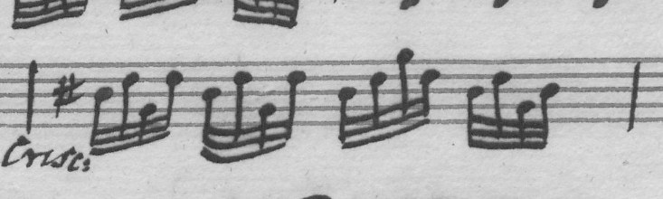

```
score  C4:32nd E4:32nd A3:32nd E4:32nd C4:32nd E4:32nd A3:32nd E4:32nd C4:32nd E4:32nd A4:32nd E4:32nd C4:32nd E4:32nd A3:32nd C4:32nd
D4     C4:32nd E4:32nd G4:32nd E4:32nd C4:32nd E4:32nd A3:32nd C4:32nd
6k     C4:32nd E4:32nd A3:32nd E4:32nd C4:32nd E4:32nd A3:32nd E4:32nd C4:32nd E4:32nd A4:32nd E4:32nd C4:32nd E4:32nd A3:32nd C4:32nd
```

**va 31** (pitch)

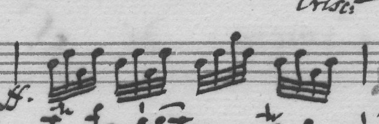

```
score  C4:32nd E4:32nd A3:32nd E4:32nd C4:32nd E4:32nd A3:32nd E4:32nd C4:32nd E4:32nd A4:32nd E4:32nd C4:32nd E4:32nd A3:32nd C4:32nd
D4     C4:32nd E4:32nd A3:32nd E4:32nd C4:32nd E4:32nd G3:32nd E4:32nd C4:32nd E4:32nd A4:32nd E4:32nd C4:32nd E4:32nd A3:32nd C4:32nd
6k     C4:32nd E4:32nd A3:32nd E4:32nd C4:32nd E4:32nd A3:32nd E4:32nd C4:32nd E4:32nd A4:32nd E4:32nd C4:32nd E4:32nd A3:32nd C4:32nd
```

**va 39** (missed)

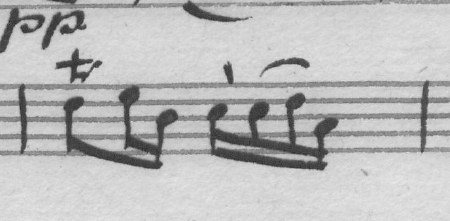

```
score  E4:8th F4:16th C4:16th D4:16th D4:16th E4:16th B3:16th
D4     E4:8th F4:16th C4:16th D4:16th E4:16th B3:16th
6k     E4:8th F4:16th C4:16th D4:16th D4:16th E4:16th B3:16th
```

**va 64** (pitch)

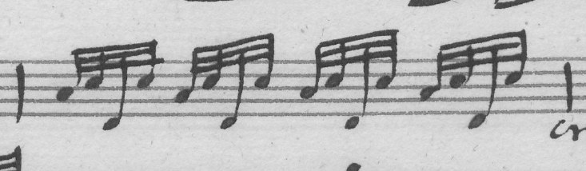

```
score  B3:32nd D4:32nd E3:32nd D4:32nd B3:32nd D4:32nd E3:32nd D4:32nd B3:32nd D4:32nd E3:32nd D4:32nd B3:32nd D4:32nd E3:32nd D4:32nd
D4     B3:32nd D4:32nd E3:32nd D4:32nd B3:32nd D4:32nd E3:32nd D4:32nd B3:32nd D4:32nd E3:32nd D4:32nd B3:32nd D4:32nd D3:32nd D4:32nd
6k     B3:32nd D4:32nd E3:32nd D4:32nd B3:32nd D4:32nd E3:32nd D4:32nd B3:32nd D4:32nd E3:32nd D4:32nd B3:32nd D4:32nd E3:32nd D4:32nd
```

**va 76** (duration)

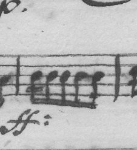

```
score  C4:16th C4:8th C4:8th C4:8th C4:16th
D4     C4:16th C4:16th C4:8th C4:8th C4:16th
6k     C4:16th C4:8th C4:8th C4:8th C4:16th
```

**va 84** (duration)

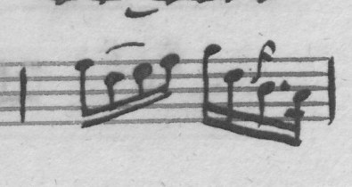

```
score  G4:16th E4:16th F4:16th G4:16th A4:16th E4:16th gD4:16th C4:16th. B3:32nd
D4     G4:16th E4:16th F4:16th G4:16th A4:16th E4:16th gD4:8th C4:16th. B3:32nd
6k     G4:16th E4:16th F4:16th G4:16th A4:16th E4:16th gD4:16th C4:16th. B3:32nd
```

**vc 51** (duration)

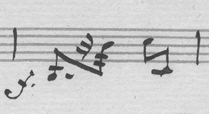

```
score  D2:8th. r32nd D3:32nd E3:8th E2:8th
D4     D2:8th r16th D3:16th E3:8th E2:8th
6k     D2:8th. r32nd D3:32nd E3:8th E2:8th
```

**vc 83** (pitch)

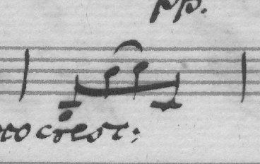

```
score  D2:8th D3:8th E3:8th E2:8th
D4     A2:8th D3:8th E3:8th E2:8th
6k     D2:8th D3:8th E3:8th E2:8th
```

**vc 87** (duration, missed)

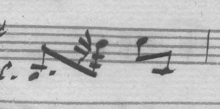

```
score  D2:8th. r32nd D3:32nd E3:8th E2:8th
D4     D2:8th. D3:16th E3:8th E2:8th
6k     D2:8th. r32nd D3:32nd E3:8th E2:8th
```

**vn1 59** (duration)

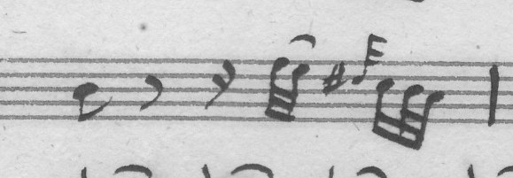

```
score  B4:8th r8th r16th F5:32nd E5:32nd gD5:32nd C5:16th B4:32nd A4:32nd
D4     B4:8th r8th r16th F5:32nd E5:32nd gD5:16th C5:16th B4:32nd A4:32nd
6k     B4:8th r8th r16th F5:32nd E5:32nd gD5:32nd C5:16th B4:32nd A4:32nd
```

**vn2 6** (pitch)

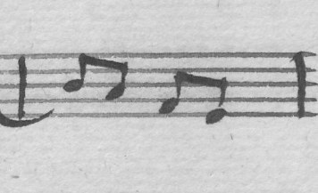

```
score  B4:8th A4:8th F4:8th E4:8th
D4     B4:8th A4:8th G4:8th E4:8th
6k     B4:8th A4:8th F4:8th E4:8th
```

**vn2 51** (duration, grace, missed)

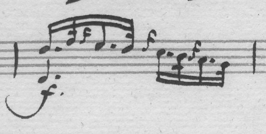

```
score  <D4 D5>:16th. F5:32nd gF5:16th E5:16th. D5:32nd gD5:16th C5:16th. B4:32nd gB4:16th A4:16th. G4:32nd
D4     <D4 D5>:16th. F5:32nd gE5:16th D5:16th. gD5:16th C5:16th. B4:32nd gB4:16th A4:16th. G4:32nd
6k     <D4 D5>:16th. F5:32nd gF5:16th E5:16th. D5:32nd gD5:16th C5:16th. B4:32nd gB4:16th A4:16th. G4:32nd
```

### Bars Boccherini 6k missed and D4 got (13)

Six are one figure in violin II (bars 26, 28, 31, 62, 66, 67): a 16th rest and three 32nds under a 3, a triplet. Boccherini 6k drops the triplet and shortens the rest to a 32nd, which also fills the bar.

**va 24** (duration)

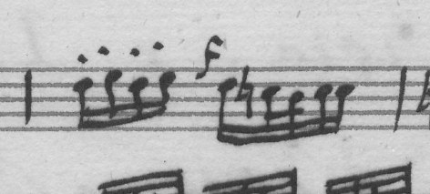

```
score  E4:16th F4:16th E4:16th F4:16th gF4:16th E4:16th D4:32nd C4:32nd D4:16th D4:16th
D4     E4:16th F4:16th E4:16th F4:16th gF4:16th E4:16th D4:32nd C4:32nd D4:16th D4:16th
6k     E4:16th F4:16th E4:16th F4:16th gF4:16th E4:16th D4:32nd C4:32nd D4:32nd D4:32nd
```

**va 51** (chord size)

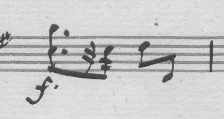

```
score  <A4 D4>:8th. r32nd D4:32nd E4:8th E3:8th
D4     <A4 D4>:8th. r32nd D4:32nd E4:8th E3:8th
6k     A4:8th. r32nd D4:32nd E4:8th E3:8th
```

**vc 24** (pitch)

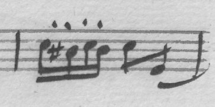

```
score  E3:16th D3:16th E3:16th D3:16th E3:8th G2:8th
D4     E3:16th D3:16th E3:16th D3:16th E3:8th G2:8th
6k     E3:16th C3:16th E3:16th D3:16th E3:8th G2:8th
```

**vn1 63** (duration)

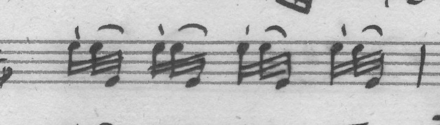

```
score  E5:16th E5:32nd E4:32nd E5:16th E5:32nd E4:32nd E5:16th E5:32nd E4:32nd E5:16th E5:32nd E4:32nd
D4     E5:16th E5:32nd E4:32nd E5:16th E5:32nd E4:32nd E5:16th E5:32nd E4:32nd E5:16th E5:32nd E4:32nd
6k     E5:16th E5:16th E4:16th E5:16th E5:16th E4:16th E5:16th E5:32nd E4:32nd E5:16th E5:32nd E4:32nd
```

**vn1 64** (duration)

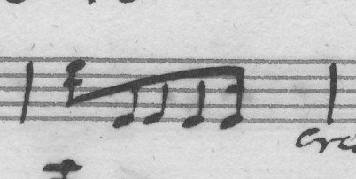

```
score  E5:16th E4:8th E4:8th E4:8th E4:16th
D4     E5:16th E4:8th E4:8th E4:8th E4:16th
6k     E5:8th E4:8th E4:8th E4:8th E4:16th
```

**vn1 66** (chord size, extra)

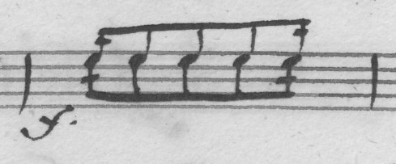

```
score  <E5 E5>:16th <E5 E5>:8th <E5 E5>:8th <E5 E5>:8th <E5 E5>:16th
D4     <E5 E5>:16th <E5 E5>:8th <E5 E5>:8th <E5 E5>:8th <E5 E5>:16th
6k     E5:16th E5:8th E5:16th <E5 E5>:8th <E5 E5>:8th <E5 E5>:8th E5:16th E5:8th E5:16th
```

**vn1 76** (pitch)

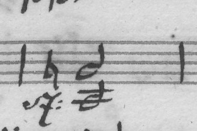

```
score  <A3 G4>:half
D4     <A3 G4>:half
6k     <G3 G4>:half
```

**vn2 26** (duration)

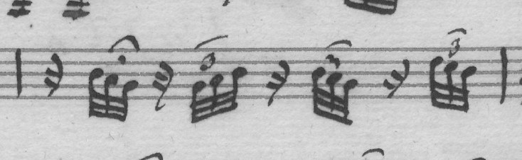

```
score  r16th B4:32nd A4:32nd G4:32nd r16th G4:32nd A4:32nd B4:32nd r16th B4:32nd A4:32nd G4:32nd r16th D5:32nd C5:32nd B4:32nd
D4     r16th B4:32nd A4:32nd G4:32nd r16th G4:32nd A4:32nd B4:32nd r16th B4:32nd A4:32nd G4:32nd r16th D5:32nd C5:32nd B4:32nd
6k     r32nd B4:32nd A4:32nd G4:32nd r32nd G4:32nd A4:32nd B4:32nd r32nd B4:32nd A4:32nd G4:32nd r32nd D5:32nd C5:32nd B4:32nd
```

**vn2 28** (duration)

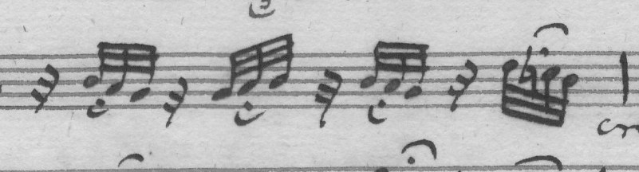

```
score  r16th B4:32nd A4:32nd G4:32nd r16th G4:32nd A4:32nd B4:32nd r16th B4:32nd A4:32nd G4:32nd r16th D5:32nd C5:32nd B4:32nd
D4     r16th B4:32nd A4:32nd G4:32nd r16th G4:32nd A4:32nd B4:32nd r16th B4:32nd A4:32nd G4:32nd r16th D5:32nd C5:32nd B4:32nd
6k     r32nd B4:32nd A4:32nd G4:32nd r32nd G4:32nd A4:32nd B4:32nd r32nd B4:32nd A4:32nd G4:32nd r32nd D5:32nd C5:32nd B4:32nd
```

**vn2 31** (duration)

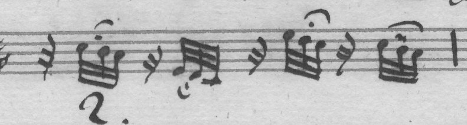

```
score  r16th C5:32nd B4:32nd A4:32nd r16th E4:32nd D4:32nd C4:32nd r16th E5:32nd D5:32nd C5:32nd r16th C5:32nd B4:32nd A4:32nd
D4     r16th C5:32nd B4:32nd A4:32nd r16th E4:32nd D4:32nd C4:32nd r16th E5:32nd D5:32nd C5:32nd r16th C5:32nd B4:32nd A4:32nd
6k     r16th C5:32nd B4:32nd A4:32nd r32nd E4:32nd D4:32nd C4:32nd r32nd E5:32nd D5:32nd C5:32nd r32nd C5:32nd B4:32nd A4:32nd
```

**vn2 62** (duration)

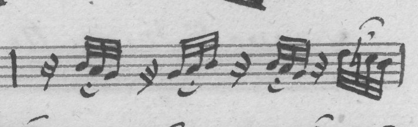

```
score  r16th B4:32nd A4:32nd G4:32nd r16th G4:32nd A4:32nd B4:32nd r16th B4:32nd A4:32nd G4:32nd r16th D5:32nd C5:32nd B4:32nd
D4     r16th B4:32nd A4:32nd G4:32nd r16th G4:32nd A4:32nd B4:32nd r16th B4:32nd A4:32nd G4:32nd r16th D5:32nd C5:32nd B4:32nd
6k     r32nd B4:32nd A4:32nd G4:32nd r32nd G4:32nd A4:32nd B4:32nd r32nd B4:32nd A4:32nd G4:32nd r32nd D5:32nd C5:32nd B4:32nd
```

**vn2 66** (duration)

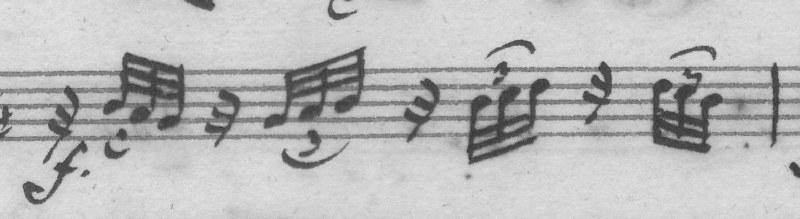

```
score  r16th B4:32nd A4:32nd G4:32nd r16th G4:32nd A4:32nd B4:32nd r16th B4:32nd C5:32nd D5:32nd r16th D5:32nd C5:32nd B4:32nd
D4     r16th B4:32nd A4:32nd G4:32nd r16th G4:32nd A4:32nd B4:32nd r16th B4:32nd C5:32nd D5:32nd r16th D5:32nd C5:32nd B4:32nd
6k     r32nd B4:32nd A4:32nd G4:32nd r32nd G4:32nd A4:32nd B4:32nd r32nd B4:32nd C5:32nd D5:32nd r32nd D5:32nd C5:32nd B4:32nd
```

**vn2 67** (duration, missed, rest for note)

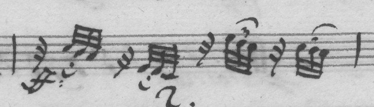

```
score  r16th C5:32nd B4:32nd A4:32nd r16th E4:32nd D4:32nd C4:32nd r16th E5:32nd D5:32nd C5:32nd r16th C5:32nd B4:32nd A4:32nd
D4     r16th C5:32nd B4:32nd A4:32nd r16th E4:32nd D4:32nd C4:32nd r16th E5:32nd D5:32nd C5:32nd r16th C5:32nd B4:32nd A4:32nd
6k     r32nd C5:32nd B4:32nd A4:32nd r32nd E4:32nd D4:32nd C4:32nd r32nd E5:32nd D5:32nd C5:32nd r32nd B4:32nd A4:32nd
```

### Dresden

p49-3: sixteenths in beamed fours. D4 wrote no beams, a slur over each group; Boccherini 6k wrote the beams, as the label has them.

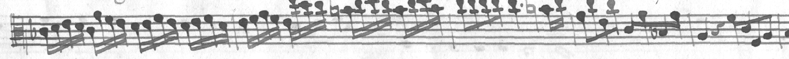

p28-2: bars 3 and 4 repeat the figure of 1 and 2. Boccherini 6k read 1 and 2, then went on with bar 5's notes: two bars gone. D4 read all of them. Of the 28 staves Boccherini 6k miscounts, 27 go wrong in the middle of the staff, not at its ends.

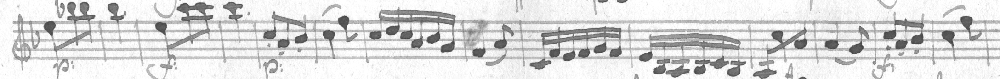

```
score  1: E5 8th B5 8th B5 8th | 2: B5 4th. | 3: E5 8th C6 8th C6 8th | 4: C6 4th. | 5: C5 8th A4 8th B4 8th
D4     the same
6k     1: E5 8th B5 8th B5 8th | 2: B5 4th. | 3: E5 8th A4 8th B4 8th | 4: C5 4th F5 8th | ...
```

## Was it the training data?

The question the traded bars raise: did the new sets teach these errors? Three checks; none found a fault in the labels.

- **The triplet figure.** Triplet 32nds appear in no set's labels, old or new (no `32nd 3in2` in dataL2, dataM, dataT, dataM5, dataW4, dataG213-4). D4 read the six bars without having been taught them; Boccherini 6k didn't. dataM5 has more 32nd rests before 32nds than D4's data (63 against 28), but the ones looked at are that figure as written (a 32nd rest and a single 32nd: F-Pn RES-507-2 p87-3, Op. 33/1 p16-6, Op. 32 p3-2, MS-1292 p15-0), not a copyist's triplet relabelled. A gap in what any set covers, not wrong labels.
- **Bar counts.** 28% of the training staves (1,681 of 6,033) have a label whose bar count differs from detection's bar boxes; a label short of the image's bars would teach skipping. In the two looked at, the label is right and detection wrong: Op. 2/4 G162 p6-3 shows the label's 7 bars (detection 8), Op. 33/4 p15-4 the label's 6 (detection 9).

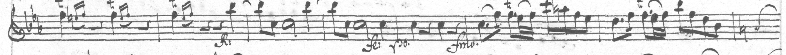

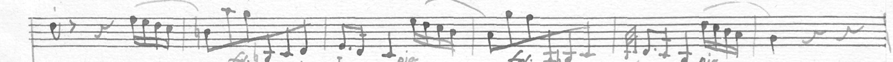

- **Sextuplets.** dataM5 holds 1,339 sextuplet tokens (`6in4`), D4's dataM 888; Boccherini 6k writes sextuplets on Dresden where there are none (134 differences). A shift in what the data has most of, which the reader then expects.

So what changed is the mix, not the labels' accuracy: more of other copyists' figures (sextuplets, other hands' beams), nothing new for the clean test's figures, and the same recipe (24 passes, now twice the steps, training loss to 0.003 with no held-out signal to stop on, as the practice exam is in training). Untested: whether fewer passes (D4's number of steps), or Op. 48's own labels weighted up, keeps the gains without the losses.

## What it means

The scaling guess (from 1,508, 2,892 and 3,411 staves: about +10 bars of
the clean test for each doubling) didn't hold. The earlier gains came
from more of the Berlin and Paris hands; the new staves are other
copyists'. They taught this copyist's beams, not its notes, and a new
habit of miscounting bars. A held-out score must compare notes and rhythm
bar by bar, as the clean test does, and report the bar count; the
all-token score rewards the labels' notation style.

## Next

1. The same data with D4's number of steps (12 passes), and with Op. 48's
   labels weighted up: about $1 each. Either may keep the beams without
   the skipped bars.
2. Score held-out staves bar by bar in notes and rhythm (a script beside
   proto.py's score), and measure how far the labels' slurs and staccatos
   are the copyist's.
3. Drawn staves of the figures no set has (triplet 32nds after a rest).
4. Detection's bar lines are off on 28% of the training staves (labels
   right where checked): the larger lever for pairing, too.

## Reproduce

```
modal volume put musvit-staves ~/.cache/manuscript-labeler/zeus/dataM5 /dataM5   # and dataW4, dataP4, dataG213-4
uv run experiments/musvit/drivers/train_b6k.py
modal volume get musvit runs/D5-B6k ~/.cache/manuscript-labeler/musvit/runs/
uv run experiments/musvit/read.py ~/Dropbox/Code/boccherini-opus-48 --run D5-B6k --file reader.pt --device mps
uv run experiments/musvit/proto.py held --init D5-B6k --init-file reader.pt --epochs 0 \
  --train <dataW4>/samples.D-Dl_Mus.3403-P-513.txt --dev <the same> --device mps
uv run experiments/musvit/release.py D5-B6k reader.pt musvit-D5b6k test --out <dir> --licence <LICENSE> --notice <NOTICE.md>
uv run reports/2026-10-20-clef-change-staves/flag_test_local.py <dir>/musvit-D5b6k@test musvit-D5b6k@test \
  e5604fd0c6e27457c36dd9afaba9bff9c749f18b3d08572f42284b04e26e1494 -- musvit-D5b6k@test musvit-D4@2026-10-20
```

The model is on the Modal volume `musvit`, `runs/D5-B6k`; the training
log is `training-log.txt` here.

## Cost

- **Modal:** $0.93 (`modal billing report --for today`): L40S $0.82, CPU
  $0.10 (5 cores), memory $0.01. Uploads free.
- **Mac (M1):** the clean test, the held-out test (three readers) and the
  flag test, about 15 min.
