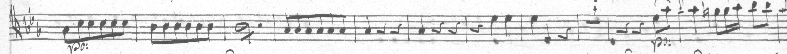
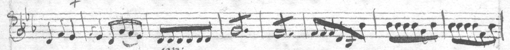
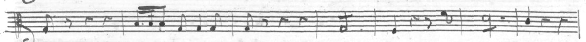
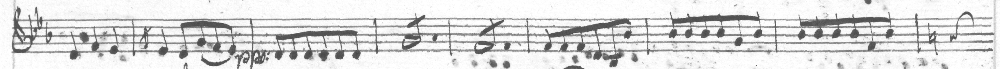
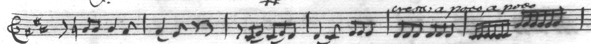

# Abbreviated notes: labelled as the copyist wrote them, +850 bars

2026-10-23. A note abbreviated by stem strokes (a dotted half with a slash
for six eighths) is how a copyist, or Philhar's encoding, saves ink; the
two don't always agree on where. No training label had ever recorded the
strokes, and where the copyist and the encoding chose differently the bar
could never pair. Labels now follow the copyist: the notes written out
where they are written out, the long note with its strokes where it is
abbreviated. The sets gain 118 staves and 850 bars; 295 labels gain their
strokes and 11 a bar corrected to the notes drawn.

| set | staves before | bars before | staves after | bars after |
|---|--:|--:|--:|--:|
| dataM5 | 4,371 | 25,215 | 4,469 | 25,887 |
| dataW4 | 1,206 | 8,322 | 1,226 | 8,500 |
| dataP4, dataG213-4 | 456 | 2,587 | 456 | 2,587 |
| **all** | **6,033** | **36,124** | **6,151** | **36,974** |

## How it was found

Asked whether the staves that didn't pair share a bias, the first idea was
to keep staves on structure: 335 unpaired staves are put out only because
some measure reads too far from its bar, though every measure pairs with
one bar. Kept where detection's bar count agreed and both end measures read
close to their bars, 90 more staves paired. By eye, three of four had one
bar whose label didn't match the page, and the rule was dropped:

- Op. 2/1 G159 p27-1, bar 2, and Op. 2/1 SA3364 p8-1, bar 3: six eighths
  written out (and read right); the encoding abbreviates them, a dotted
  half with :8.
- Op. 22/6 Vmbr153 viola p35-3, bar 4: the reverse, the copyist's dotted
  half with a stroke, the encoding's six eighths.

Zeus's LMX has tremolo tokens (`tremolo:single`, `tremolo:1` to `4`), but
no set used them: the edition's events.py doesn't record the strokes, so a
label wrote the long note alone. Philhar abbreviates 584 notes so (`c2.:8`),
most in Op. 24, 32 and 33, and 15 passages with `\repeat tremolo`.

## The change

- **philhar.py** adds a listener for tremolo events to the engraver it
  already adds (the one that finds bar lines inside bars): each abbreviated
  note's place and the value it stands for go into --json as the note's
  "tremolo". `written_out` writes such a note out: its value repeated over
  its span (a tuplet's notes share the shorter span), beamed together, its
  slur and marks on the first, its tie on the last.
- **autopair.py**: the alignment sees each bar as encoded, as before; then
  each bar with abbreviations takes the form its measures read more like,
  and a kept staff lists the bars it holds written out ("written_out").
  (With both forms inside the alignment, bars of repeated notes were like
  too many measures: Rochester M351's trios drifted 19 bars off and lost 7
  staves. Choosing after keeps every alignment as it was.)
- **dataset.py**: a staff's written-out bars are labelled so; elsewhere an
  abbreviated note carries MusicXML's single tremolo, its strokes counted
  apart from its own flags (a dotted half for eighths: one), which the LMX
  encoder writes as `tremolo:single tremolo:1`.

Tests: tests/test_tremolo.py.

## What it found

- 122 more staves paired (933 bars), none lost, no kept staff's bars moved;
  118 into the sets (850 bars).
- Labels: 1,581 tremolo marks in the sets (dataM5 1,545, dataW4 36; G. 213's
  MusicXML already had 270). Of the labels kept before, 5,726 are as they
  were, 295 gained strokes, 11 a bar written out.
- By eye:
  - Op. 2/1 G159 p27-1 now pairs: bar 2 six eighths written out, bar 3 a
    dotted half with its stroke, bar 4 six eighths, each as drawn.
  - Op. 2/1 G159 p20-1: bar 3 written out, bars 4 and 5 dotted halves with
    strokes, as drawn.
  - Op. 32 p74-3, kept before with a wrong bar: bar 6 is two groups of six
    sixteenths, both written out; the label had the second as a dotted
    quarter, and now has the sixteenths.

- One staff written out inside a triplet (Op. 32/5 I, vn2, bar 32: a dotted
  quarter :16 lasting a quarter) failed the read-back check until the
  written-out notes shared the shorter span; it passes now.

## Not done

- `\repeat tremolo` (two notes alternating, 15 passages) isn't recorded.
- The reader hasn't been trained on the new labels: the next run will be
  the first to see stem strokes in a label.
- The other systematic gaps in the left-out staves: multi-bar rests (251),
  clef changes on the staff (182), a bar a repeat splits read as one
  measure (166).

## Cost

Mac (M1) CPU: three full re-pairs (about 4 min each) and three set builds
(about 8 min each), the structure rule tried and dropped, checking by eye;
about 2 h. No Modal.
