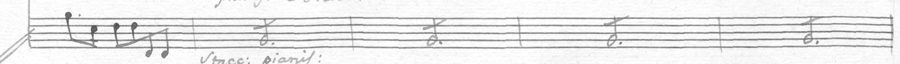
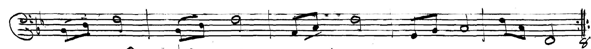
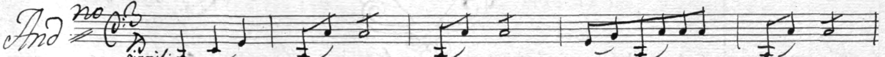
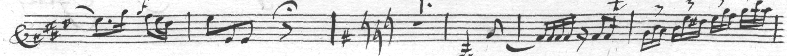
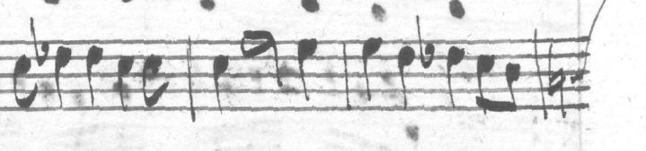

# Bar lines counted on the paired manuscripts: more pages won't do it

2026-10-23. The pairing gives 6,033 staves, in many copyists' hands, a bar
count checked against the score. Used as a test of the labeler's bar-line
detection, they show it counts a staff's bars right on 73% of them; and that
neither more of the editor's reviewed pages nor training on those counts
moves that much. The labels, where the count and detection disagree, were
right every time looked at.

## Detection's count against the labels'

A staff's detected count is its bar boxes, as autopair.boxes counts them
(bar lines past the music start, and one more where music runs on past the
last); the label's is its measures. Over the 6,033 staves in the training
sets (dataM5, dataW4, dataP4, dataG213-4), as the pairing recorded them:

| | staves | share |
|---|--:|--:|
| count right | 4,397 | 72.9% |
| one too many | 540 | 9.0% |
| more than one too many | 133 | 2.2% |
| one too few | 379 | 6.3% |
| more than one too few | 569 | 9.4% |

The detection behind these is the labeler's: the learned bar-line filter
with the detectors' votes and staff ends (server.Edition.detect). Without
the detectors, on a held-out sample of 156 pages (879 staves, 3 per source),
the filter alone counts 42% right; with them, 74%.

## Are the labels or detection wrong?

Where the two disagree, the staff was looked at. Six of six: the label's
count is the page's.

| staff | label | detection | the page |
|---|--:|--:|---|
| Op. 33/1 G207 p6-7 | 5 | 2 | 5: four bar lines missed |
| Rochester M351 p87-0 | 5 | 4 | 5: a faint bar line missed |
| Op. 22/6 Madrid p2-0 | 5 | 7 | 5: the stems of low notes taken for bar lines |
| Op. 32 p13-9 | 6 | 7 | 6 |
| Op. 2/4 G162 p6-3 | 7 | 8 | 7 (reports/2026-10-22-boccherini-6k) |
| Op. 33/4 G210 p15-4 | 6 | 9 | 6: three stems (bar lines found at 0.25, 0.34 and 0.66 of the staff) |

So the training labels aren't wrong here: they come from the score, a
custos or a stray stroke can't become a note in them, and the pairing's
bar counts held up. Detection's errors cost the pairing staves (a staff
is put out where its counts disagree and its ends can't vouch for it), not
the labels their accuracy.

Some of the extra counts aren't the filter's: of the 540 staves one bar
over, 298 have music past their last bar line, median 3.3 staff spaces.
At Op. 2/2 G160 p13-4 that is a key change written after the line's last
bar line, which the box count takes for one more bar.

## More reviewed pages: the learning curve

The filter trained on a quarter, a half and all of the editor's 111
reviewed pages (RES-507-18's 11 included), scored on the same 156 held-out
pages (experiments/barlines/paired_curve.py):

| reviewed pages | count right |
|--:|--:|
| 27 (two draws) | 77.0%, 76.8% |
| 55 (two draws) | 77.4%, 75.7% |
| 111 | 77.1% |

Flat. The reviewed pages are a few copyists (Berlin, Paris); more of them
won't make the filter 5–10% better on others.

## Training on the paired counts

experiments/barlines/paired_counts.py: three filters through the labeler's
detection on the held-out pages.

| filter | count right | too many | too few |
|---|--:|--:|--:|
| A, each source's own, as detected (66–94 reviewed pages) | 76.8% | 115 | 81 |
| B, the 99 reviewed pages then | 77.0% | 110 | 85 |
| C, B's pages and 300 paired pages (1,481 staves) | 77.9% | 120 | 67 |

C's paired staves are labelled by the count: on each, B's likeliest
strokes, as many as the staff's bar count needs, are its bar lines (a
staff where both readings of the count fit, or neither, is left out). It
finds more of the bar lines B misses (too few 85 → 67) but takes more
strokes for them too (110 → 120): +1 point.

## What would

Not more of the same pages. The errors have causes a rule can meet:
- stems that cross the whole staff, from low or high notes, taken for bar
  lines (a bar line has no notehead at either end);
- the box count's open last box, which takes a key change, clef or custos
  after the line's last bar line for a bar;
- faint bar lines missed (the paired counts help a little).

## Cost

Mac (M1) CPU: the paired-counts experiment about 40 min, the learning
curve about 30 min, the audit by eye about 15 min. No Modal.
