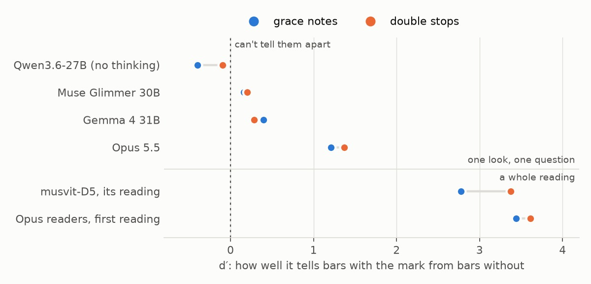
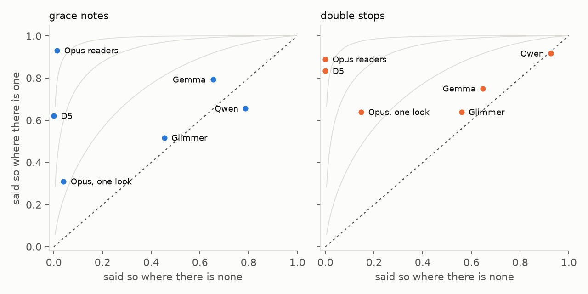

# Open vision models as the edition's reader: what we learned, and when to try one again (2026-11-03 to 11-04)

The edition's readers are Claude Opus 5.5 agents inside `/encode`. On
Op48-4 I they got 269 of 290 bars exact, against 231 for musvit-D5, the
model that reads the edition's drafts. Could an open model do the
readers' work, on our own GPUs, and later be fine-tuned for it? We tried
three: Qwen3.6-27B, Gemma 4 31B and Meta's Muse Glimmer 30B.

**Not these models. The limit is what they can report seeing, not how
they reason or how we use them, and that can be measured in 15
minutes.** Asked one
closed question about one bar ("how many grace notes are in this
bar?"), each of the three says yes about as often when there is none as
when there is one (d′ between −0.4 and 0.4, where 0 is chance). Opus,
asked the same, rarely claims a mark that isn't there (d′ 1.2-1.4). A
model that can't see the marks can't be helped by a better procedure: given
D5's reading to check, in a loop that enforced every step and showed
Opus's own worked examples, Gemma fixed none of D5's wrong bars and broke
right ones. More thinking made its answers worse, not better.

**When to try an open vision model again:** when it passes the seeing
test (`experiments/llm/see_test.py`, below). On the 104 bars of Op48-4 I
used here, it should tell bars with a grace note or a double stop from
bars without about as well as Opus does in one look (d′ of about 1.2 or
more, defined below) on both questions. Only then is the checking loop
(section 3) worth running, and even then only a flag confirmed by a
closer look should change a bar.

*Figure 1. How well each reader tells bars with the mark from bars
without (d′; 0 is chance). Above the line: a model shown one bar and
asked one closed question. Below: whole readings of the same bars, D5's
and the Opus readers' (with all their tools), counted the same way.*

## What we learned

1. **Reading a whole bar in one look decides nothing.** Every model,
   Opus included, gets few bars exact that way (Opus 1 of the pilot's 10;
   the open models 2-7% of KHM 602 II). A gate set on it (20% exact) was
   wrong and was withdrawn: Opus would have failed it too.
2. **As the reader, the open models broke the procedure in three
   different ways.** Qwen thought in circles for 317,000 tokens and
   wrote nothing. Gemma looked at 2 of 14 bars and wrote a made-up
   sequence. Glimmer looked at every bar and wrote filler. Opus thinks
   briefly and often, and settles each doubt by looking again with a
   tool.
3. **Help doesn't save a model that can't see.** With D5's draft to
   check, a loop that keeps the procedure, the staff lines named on the
   picture, and worked examples in Opus's own words, Gemma fixed 0 of
   D5's 8 wrong bars in violin II 0-20 and broke 5 or 6 of its 13 right
   ones.
4. **Seeing can be measured on its own, with closed questions.** The
   three open models' d′ is between −0.4 and 0.4: none can tell bars
   with these marks from bars without. Opus's is 1.2-1.4 in one look.
   They differ in leaning, not in seeing: Qwen says yes to nearly every
   bar, Glimmer to about half, Gemma to two thirds (Figure 2). This tests
   the whole chat model, picture in and words out. It doesn't show that
   the marks are missing from what the model's vision encoder computes.
   The MuSViT paper ([arXiv 2606.31811](https://arxiv.org/html/2606.31811v1))
   froze Qwen3-VL-8B's encoder and trained a small reader on it (two LSTM
   layers and a CTC head, fitted to each corpus's labelled staves). Its
   symbol error rate on single staves averaged 21.0 against MuSViT's
   18.4. On full pages it was 51.0 against 16.4. On FMT, the one
   handwritten corpus in modern notation, both were near 30. So Qwen's
   encoder holds much of the music. What the chat model lacks is a way
   to say what it sees, and getting that takes a trained head on labelled
   staves, which is what D5 is, on a better encoder.
5. **Reasoning is not the missing part.** Gemma's thinking was on and
   seldom reached its cap, and its longer answers were wrong more often
   (40 of 104 right in the longer half, 60 in the shorter). Qwen,
   thinking, ran past 12,000 tokens without answering on 189 of 208
   questions, just as it circled for 317,000 tokens as the reader. Each look
   Opus takes tells it something true; theirs don't, so more looks and
   more thought add errors.
6. **Bigger pictures don't help.** Gemma's largest picture budget and
   Glimmer at 80 px a staff space did no better than the defaults. The
   bar is plain at 40 px.
7. **Opus's procedure nearly triples what it sees.** In one look its d′
   is 1.2-1.4; as the readers, with zooms, the engraving compared with
   the page and the head check, 3.4-3.6. The procedure works because
   each look adds a little true evidence.
8. **D5 is a strong specialist with two blind spots.** On the same bars
   its d′ is 2.8-3.4, with no false marks at all. It misses the grace
   notes in 11 of the 29 bars that have them, and a double stop in 8 of
   36. Opus in one look finds only 1 of the 11 grace notes D5 missed:
   this hand's grace note is a small head on a stroke that curls down,
   easily taken for a flourish (`grace-note-vn2-4.jpg`).
9. **These marks are rare, so measure them with rates, not percent
   right.** Grace notes are in about 10% of bars, double stops 12%, and
   D5's misses 3-4%. A model that always says "no" is right 69% of the
   time on the test. At the movement's real rates, even Opus's one-look
   flags would be about half false. A flag is worth acting on only when
   something confirms it.

## Where to go next

- **Train D5 on its blind spots.** Grace notes are about 2% of notes, so
  training that rewards getting most notes right learns little about
  them. Oversample staves with grace notes and double stops, or weight
  those tokens, and score each kind of mark by its hit rate and
  false-alarm rate (or d′), not by bars exact. Grace notes are a matter
  of the hand (D5 finds all of KHM 603's). Every D5 variant misses about
  half of the double stops on KHM 603, so they are the bigger target (section "D5's
  design", below). Synthetic staves could add
  grace notes, but on this hand renders hurt Segment Anything
  ([2026-10-19](../2026-10-19-segment-anything/)), so mix them with real
  ones.
- **Give MuSViT the reasoning loop, not a reasoner the eyes.** This
  experiment began from Opus's reasoning, but what its procedure does is
  propose a reading, ask narrow questions, look again, and keep what the
  page confirms. MuSViT sees the marks better than any general model's
  encoder; what it can't do is answer a question. Three ways to add
  that, cheapest first:
  1. *Propose and check:* D5 samples several readings of a bar; each is
     engraved and the one that best matches the picture is kept. Beam
     search with a bar-length penalty didn't help (most errors keep the
     bar's length), so the check must look at the picture.
  2. *Closed-question heads:* small heads on MuSViT's features trained to
     answer the seeing test's questions (any grace note, how many heads
     on a stem), from labels the encodings already give. A reasoner, open
     or Opus, calls them as tools; `see_test.py` scores them by d′. They
     are also the per-mark training D5 needs. **First tries (section 5): on D5's
     encoder as good as D5's own reading and blind where D5 is; on the
     pretrained encoder, 3 of D5's 11 missed grace-note bars found.**
  3. *A bridge into a language model:* MuSViT in place of a
     vision–language model's own encoder, with a trained projection
     between them. The full answer, but the language half must learn
     notation, which is a large project.
- **Gate every new model with the seeing test first.** Legato 2 when its
  weights arrive, a later Gemma or Qwen, DeepSeek-OCR or any other: 15
  minutes and about $2 on a rented GPU, before anything bigger.
- **Opus checking D5's draft** (not tried). If checking a draft costs
  Opus fewer tokens than reading from empty, at the same accuracy, the
  edition's reading gets cheaper. `check_read.py` runs any model with a
  vision API; it would need an Opus backend.
- **Worked examples are already in the edition's records.** Opus's
  thinking isn't kept in the transcripts, but each bar's record says
  what it saw, note by note, and why it changed what it changed. If an
  open model ever passes the gate, those records are its examples; a
  "what I saw" field in every record would give more.

## Measuring seeing: d′

d′ ("d-prime", from signal-detection theory) says how well a reader
tells two cases apart, here bars with a grace note from bars without,
whatever its leaning towards yes or no. Take the share of bars with the
mark where it says yes (the hit rate) and the share without the mark where
it says yes (the false-alarm rate); turn each into a z-score (50% is 0,
84% is +1, 16% is −1); d′ is the first minus the second. A reader that
says yes more often raises both rates and keeps its d′. 0 means it says
yes as often either way; 1 is a modest real difference; 2 and above,
it rarely confuses them. A rate of 0 or 1 is corrected (half a bar added
to each count) so d′ stays finite.

Percent right mixes leaning and seeing: a cautious reader, or one that
always says no, scores well on rare marks. Figure 2 shows both at once.

*Figure 2. Each reader's hit rate against its false-alarm rate, per
question. The dotted diagonal is chance; the grey curves are d′ 1, 2 and
3. Up and to the left is better. A cautious reader sits low and left
(Opus on grace notes); one that says yes to nearly everything, high and
right (Qwen, Gemma), and on the diagonal it sees nothing.*

## D5's design, and where its blind spots come from (2026-11-05)

The MuSViT paper's staff-level comparison (lesson 4 above) and D5 are
built differently:

| | the paper's probe | musvit-D5 |
|---|---|---|
| encoder | frozen | MuSViT-Base, adapted (LoRA rank 64, attention and MLP) |
| reader on top | 2 BiLSTM layers and a CTC head: one symbol per column, in one pass | an 8-layer transformer decoder writing LMX a token at a time, attending to the whole staff |
| training | each corpus's own staves | Public 9k → Drawn 11k → Boccherini 6k (Op. 48 three times), staves 96 px high |

The paper's probe is a fair way to compare encoders. It is a lower bound
on what either encoder can do. We built Zeus's LSTM design on MuSViT
ourselves, and it was our weakest reader (221 of the clean test's 347
bars, against 263-265 for transformer decoders;
`experiments/musvit/README.md`).

Is D5's design what limits it on grace notes and double stops? The
musvit readers' readings of the clean test (KHM 603 I, a copyist in
training), counted as in the seeing test, say no:

| readers | strips | bars with a grace note found | grace notes found | bars with a double stop found | double stops found |
|---|---|---|---|---|---|
| D3 and two siblings | 128 px | 22-24 of 24 | 29-32 of 34 | 15-19 of 28 | 27-32 of 53 |
| D4, D5 and six siblings | 96 px | 24 of 24 | 31-34 of 34 | 14-18 of 28 | 23-33 of 53 |
| C0, C2 (4-layer decoder) and C1, C4 (8-layer) | 128 px | 24 of 24 | 32-33 of 34 | 16-18 of 28 | 26-32 of 53 |

Every reader has at most 1 false mark in about 320 bars without one.
Counted from `experiments/zeus/results/D-B_KHM-603-I-musvit-*.json`.

- **Grace notes depend on the hand, not the design.** On KHM 603 every
  reader finds nearly all of them, at either strip height. The smaller
  96 px strips cost nothing. The grace notes D5 misses on Op48-4 I are in
  another copyist's hand (RES 507 (16)), with a small head on a stroke
  that curls down. The fix is more staves of hands like that one.
- **Double stops are a blind spot every variant shares.** Every variant
  finds roughly half of them, at either height, with 4 or 8 decoder
  layers, with or without the drawn stage. None of the design changes
  tried moved it. It is most likely the training data: double stops
  are few, and two-voice bars were left out of the first readers' training.
  Oversampling them, weighting their tokens, or drawing staves full of
  them are the untried levers.

So D5's design is the best of those tried, judged on bars exact. It was
never judged on rare marks. On the evidence here, data is the lever for
both blind spots, not the design.

## 1. One look a bar (2026-11-03)

`experiments/llm/bars.py`, the 9 October pilot, with `--backend openai`:
the same prompt, the same 40 example bars with their answers, the same
crops (40 px a staff space, clef, key and time given) and the same scoring
by compare.py's rules against the edition's notes. All 284 whole bars of
KHM 602 II, two sampling seeds, thinking off. Each model is served by
vLLM on Modal (`experiments/llm/vllm_modal.py`), its answers held to the
schema by vLLM's structured output.

| reader | bars | exact | rhythm right | pitch right |
|---|---|---|---|---|
| Qwen3.6-27B (FP8, L40S), seeds 1, 2 | 284 | 8, 7 (3%, 2%) | 74, 68 (26%, 24%) | 12, 13 |
| Qwen, asked for the rhythm alone (`--ask rhythm`), seeds 1, 2 | 284 | | 61, 72 (21%, 25%) | |
| Gemma 4 31B (bf16, H100), seeds 1, 2 | 284 | 19, 16 (7%, 6%) | 103, 100 (36%, 35%) | 20, 17 |
| Gemma, 1,120 tokens a picture, seeds 1, 2 | 284 | 16, 16 (6%) | 77, 80 (27%, 28%) | 21, 19 |
| Muse Glimmer 30B (bf16, H100), seeds 1, 2 | 284 | 19, 12 (7%, 4%) | 108, 95 (38%, 33%) | 22, 14 |
| Glimmer, crops at 80 px a staff space, seed 1 | 283 | 11 (4%) | 83 (29%) | 14 |
| Zeus untrained (ayce, 2026-10-11) | 284 | 127 (45%) | 155 (55%) | 176 (62%) |

On the pilot's 10 bars (viola 1-10):

| reader | exact | rhythm right | pitch right |
|---|---|---|---|
| Opus 5.5, low / high effort | 1, 1 | 5, 4 | 2, 3 |
| Gemma 4 31B, seeds 1, 2 | 1, 0 | 4, 4 | 1, 0 |
| Qwen3.6-27B, seeds 1, 2 | 0, 0 | 2, 3 | 0, 0 |

- **Qwen:** 80 and 86 of 1,012 events right, with errors of every kind
  (591 pitch, 460 duration in seed 1). It reads the top of the viola's
  double stops a third high and calls a bar rest a half note.
- **Gemma:** 155 and 148 events right, nearly twice Qwen's, but 253 added
  that aren't there and 634 pitches wrong. Its model card's sampling
  (temperature 1.0, top_p 0.95, top_k 64).
- **Glimmer:** 154 and 125 right, level with Gemma; far fewer added (57)
  but more missed (72). It has no switch to turn thinking off, so it ran
  at its lowest reasoning strength, about an hour a seed.
- **Bigger pictures.** Gemma scales each picture to fill its budget: at
  its default 280 tokens a token covers about 30 px of a bar crop, three
  quarters of a staff space, where a pitch needs half a space. At 1,120
  tokens it got no more bars exact, fewer right in rhythm, and added more
  events (326 and 333). Glimmer at 80 px a staff space did no better than
  at 40. The crops are cut from page renders at about 16 px a staff
  space (the scan has about 24), so both sizes enlarge the same picture,
  and the bar is plain at 40 px (`bar-40-vs-80-px.jpg`, violin I bar 5).
- **Rhythm alone** didn't help Qwen: a narrower question doesn't make it
  see beams and flags better.
- D5 is not in the tables: it probably trained on KHM 602.

## 2. As the edition's reader (2026-11-04)

`experiments/llm/agent_read.py` gives an open model the reader's prompt
word for word as `.claude/workflows/encode.js` builds it, and the encoder
agent's tools (a shell, reading a file or a picture, writing a file),
with pictures shrunk as Claude Code shrinks them for Opus. The edition is
a clone at the commit Op48-4 I's readers started from (3205935), its run
folder holding only the files written before reading began, its note
files seeded by `encode.py seed`. Served with a 128k context and tool
calls (`VLLM_AGENT=1`). Scored by `score_agent_read.py` against the
person's final notes, as the edition's `d5_measure.py` scores its
readers.

**Violin I, bars 0-13 (the first reader's chunk):**

| reader | bars exact | output tokens | turns | longest reply |
|---|---|---|---|---|
| Opus readers' first reading | 12 of 14 | about 117,000 | 135 | 3,900 tokens |
| musvit-D5 | 12 of 14 | | | |
| Qwen3.6-27B (H100) | 0 (none written) | 317,000 in 75 minutes | 12 | 32,768 (cut off 8 times) |
| Gemma 4 31B (H200; thinking capped at 4,096 a reply) | 0 of 14 (none right in rhythm) | 31,600 in 26 minutes | 23 | |
| Muse Glimmer 30B (H100; medium reasoning) | 0 of 14 (1 right in rhythm) | 18,500 in 19 minutes | 92 | 1,832 |

- **Qwen** read the rules and the copyist notes, zoomed every bar and
  looked at each. Then its thinking went in circles ("looking at the image
  more carefully..."). It took the movement for 3/4 for some 50,000
  tokens before reading `Structure.ily` (2/4). From turn 11 every reply
  ran to the 32,768-token cap without acting; told twice to act, it
  still didn't write. (A first attempt stopped after 8 turns, when the
  loop took a cut-off reply for the answer; the loop now asks again.)
- **Gemma** zoomed five times but looked at only three pictures. It wrote
  bars 1-13 as a falling sequence (`c8 b c4 c4`, `b8 a b4 b4`, ...), some
  too long for a 2/4 bar, which the music doesn't have. Each bar's record
  lists two pictures as looked at. It ran `compare.py` five times and
  never looked at what it made.
- **Glimmer** read the rules, the plan, the copyist notes and
  `Structure.ily`, looked at all 18 zooms, then wrote each bar as one
  pitch in eighths (`e8 e8 e8`, `g8 g8 g8`, ...). It ran the head check
  once and never compared its engraving with the page.
- **Opus** (from its transcript: its thinking isn't kept, its calls are)
  read `Structure.ily` sixth, thought briefly and often, settled doubts
  with some 20 extra zooms (half bars at 100-150 px a staff space, taller
  views, the other parts' bar 0), wrote the 14 bars, checked them with the
  overlay and the head check, and fixed bar 11.

## 3. Checking D5's draft, with help (2026-11-04)

If the trouble was the procedure, the usual help should fix it: give the
model a draft to check instead of a page to read, make the loop keep the
procedure, and show it how Opus works.

- **The draft** (`d5_draft.py`): D5's own reading of Op48-4 I (the run's
  `d5/reading.json`), each bar parsed as the scoring parses it, written
  into a copy of the edition's note files in absolute pitches, so a
  corrected bar can't move the octave of the next. It scores 231 of 290
  bars exact, D5's own count.
- **The loop** (`check_read.py`): for each bar, the model is shown the
  zoom (each staff line and space named with its pitch), the comparison
  (the bar over its engraving, measured heads circled) and the head
  check's flags. It says what it sees, head by head, then gives the
  bar's line. A changed line is engraved and shown again, up to twice; a
  line LilyPond can't read, or too long or short for the bar, is sent
  back. Gemma 4 31B, thinking up to 4,096 tokens a reply.
- **Worked examples** (`--examples`): six bars of Op48-4 II (the same
  hand, another movement), five D5 read wrong and one right, each with
  its zoom, D5's line, the Opus reader's own account of the bar from its
  record ("six 8ths, stems down: four under one beam (F4 centred in the F4
  space, G4 on the G4 line ...") and the final line.

**Violin II, bars 0-20** (D5's misses here: four grace notes, the lower
note of four double stops):

| | exact | D5's wrong bars fixed | D5's right bars broken |
|---|---|---|---|
| D5's draft | 13 of 21 | | |
| Gemma checking it | 7 | 0 of 8 | 6 of 13 |
| Gemma checking it, with the worked examples | 8 | 0 of 8 | 5 of 13 |
| Opus readers' first reading (for scale) | 16 | | |

Gemma saw what isn't there (a three-note chord where the page has two
quarters), wrote octaves wrongly in its own corrections (`d'16`, D4, for
the D5 it named), and twice followed a false flag of the head check into
breaking bar 15. Its second look confirmed its changes rather than
catching them.

## 4. Can it see the marks? (2026-11-04)

`see_test.py` asks only about seeing. Every bar of Op48-4 I whose final
notes hold a grace note (29) or a double stop (36), and 40 bars with
neither: 104 bars. Each is shown alone at 100 px a staff space, its lines
and spaces named, with two closed questions asked apart: how many grace
notes (with a description of how they look), and how many stems carry two
or more heads. Gemma and Glimmer think first (Glimmer at medium
reasoning strength); Opus at high effort. Qwen, thinking, used up 12,000
tokens without answering on 189 of 208 questions, so it is shown without
thinking. Glimmer ignores the answer format (vLLM doesn't hold it to
one), so it alone was asked to end with a line `COUNT: n`. D5's
reading and the Opus readers' first reading of the same bars are counted
the same way (does the reading have a grace note, a chord, in the bar).
D5 never trained on these staves.

| | grace: said so, there | none there, said one | d′ | double stop: said so, there | none there, said one | d′ |
|---|---|---|---|---|---|---|
| Qwen3.6-27B (no thinking) | 19 of 29 | 59 of 75 | -0.40 | 33 of 36 | 63 of 68 | -0.09 |
| Muse Glimmer 30B | 15 of 29 | 34 of 75 | 0.16 | 23 of 36 | 38 of 68 | 0.20 |
| Gemma 4 31B | 23 of 29 | 49 of 75 | 0.39 | 27 of 36 | 44 of 68 | 0.28 |
| Opus 5.5 | 9 of 29 | 3 of 75 | 1.21 | 23 of 36 | 10 of 68 | 1.37 |
| musvit-D5, its reading | 18 of 29 | 0 of 75 | 2.78 | 30 of 36 | 0 of 68 | 3.38 |
| Opus readers, first reading | 27 of 29 | 1 of 75 | 3.44 | 32 of 36 | 0 of 68 | 3.61 |

A d′ below 0 is chance with noise: Qwen says yes to almost every bar.

Of the bars where D5 missed the mark, Gemma said so for 7 of 11 grace
notes and 3 of 8 double stops, Opus in one look 1 of 11 and 5 of 8; but
Gemma says so as often where there is nothing. Gemma's thinking reached
its 2,048-token cap in 11 of 208 answers.

## 5. Question heads on MuSViT's vectors (2026-11-05)

`experiments/musvit/questions.py`. D5's encoder, frozen, ran once over
the 6,392 staves D5 trained on. That took 17 minutes on the Mac, and its
patch vectors are kept in `~/Data/manuscript-labeler/musvit/questions`.
A small head gives each patch a count for each question: an MLP, then a
convolution across columns. It is trained only on each staff's totals,
read from the LMX, with no positions labelled: 4,060 grace notes and
3,476 stems with two or more heads. A bar's answer is the sum over the
columns inside its box. The test is the seeing test's 104 bars of RES
507 (16), a copy no reader trained on; a count of 0.5 or more means yes.

| | grace notes: there, said so | none there, said one | d′ | double stops: there, said so | none there, said one | d′ |
|---|---|---|---|---|---|---|
| question heads (Q1) | 14 of 29 | 0 of 75 | 2.44 | 26 of 36 | 0 of 68 | 3.02 |
| D5's reading | 18 of 29 | 0 of 75 | 2.78 | 30 of 36 | 0 of 68 | 3.38 |
| Opus, one look | 9 of 29 | 3 of 75 | 1.21 | 23 of 36 | 10 of 68 | 1.37 |

- **The heads see what D5 sees, no more.** Their d′ is D5's within the
  noise of 29 and 36 bars, and far above any general model's one look,
  Opus's included. No bar without a mark scores above 0.03.
- **They are blind where D5 is.** Of the 11 bars whose grace note D5
  missed, the heads score none above 0.23; of the 6 double stops D5
  missed, none above 0.03. "D5 or the heads" finds 18 of 29 and 30 of
  36, exactly D5's own. The marks D5 misses aren't in its encoder's
  vectors in a form a head can find. Asking differently doesn't recover
  them; training the encoder on this hand would.
- **They are cautious.** Every bar without a mark scores 0.03 or less,
  and several bars with one score between 0.05 and 0.4. A threshold
  chosen on the practice exam, not 0.5, would find more; it wasn't tuned
  on the test.

So the heads give a reasoner D5's seeing as answers to questions, with
almost no false marks, but they don't add seeing. On D5's practice-exam
staves (which D5 trained on, so flattering) a staff's answer has d′ 3.9
(grace notes) and 4.0 (double stops).

**Is D5's last layer the right place for them?** It is what D5's decoder
reads, shaped by D5's training for transcription; detail the decoder
didn't need may be gone there. The same heads were trained on two other
sets of vectors: D5's encoder at its middle layer (6 of 12), and MuSViT
as pretrained, before any reading was trained on it, at its last and
middle layers.

| head on | grace notes: there, said so | d′ | of D5's 11 misses, found | double stops: there, said so | d′ | of D5's 6 misses, found |
|---|---|---|---|---|---|---|
| D5, last layer (Q1) | 14 of 29 | 2.44 | 0 | 26 of 36 | 3.02 | 0 |
| D5, middle layer (Q2) | 12 of 29 | 2.27 | 0 | 26 of 36 | 3.02 | 0 |
| MuSViT pretrained, last layer (Q3) | 17 of 29 | 2.69 | 3 | 14 of 36 | 2.17 | 1 |
| MuSViT pretrained, middle layer (Q4) | 10 of 29 | 2.09 | 2 | 13 of 36 | 2.10 | 0 |
| D5 and MuSViT pretrained, last layers side by side (Q5) | 15 of 29 | 2.52 | 0 | 21 of 36 | 2.65 | 0 |

None says a mark is there in any bar without one.

- **The pretrained encoder keeps some grace notes D5's lost.** Its last
  layer finds 3 of the 11 bars D5 missed (violin II 4, 49 and 50), and
  its middle layer finds 2 of them; D5's encoder, at either layer,
  finds none. With D5, the pretrained head finds 21 of 29 bars. D5's
  training made its encoder drop some of what the pretraining kept.
- **D5's training is what makes double stops visible.** On the
  pretrained vectors a head finds 13-14 of 36, against 26 on D5's.
- **D5's middle layer adds nothing.** Inside D5's encoder the grace notes
  are lost by the middle layer already, or were never separated there.
- **Most of D5's misses are seen by nothing.** Eight of the 11 grace-note
  bars (violin I 17-22, violin II 16-21) score low on every head, and
  Opus's one look missed them too. Only the Opus readers, zooming, found
  them. There the information isn't in a 96 px strip in a form any of
  these encoders keeps: new pixels (a closer crop) or training on this
  hand are the remaining levers.

**Both at once (Q5) is worse than either.** A head reading D5's and the
pretrained encoder's last layers side by side finds 15 of 29 grace-note
bars and 21 of 36 double stops, none of D5's misses, and no false marks.
On the practice exam it is the best of all (d′ 4.2 and 4.0). The reason
is the training staves: they are D5's own, so D5's vectors fit their
labels almost perfectly, and a head given both leans on D5's and ignores
the rest. The same bias flatters every head on D5's vectors here. A fair
test of what an encoder keeps needs heads trained on staves D5 never
saw: Dresden's 353, or KHM 587's.

So D5's training traded some grace-note detail for much better double
stops; the pretrained encoder keeps a little of that detail; and most of
D5's misses (8 of 11) are kept by no encoder at 96 px. Those need new
pixels, as the Opus readers got by zooming, or this hand's staves in
training.

## Things that tripped us up

- **The run's `d5/read/` is the Opus readers' first reading, not D5's.**
  `d5_measure.py` keeps both; D5's own is `d5/reading.json`. The first
  draft built from the wrong one scored as Opus does.
- **D5 misreads the key on later staves** (two sharps for three flats).
  The scoring ignores the key (it compares letters, octaves and the
  accidentals drawn), so the draft takes the key from the labels.
- **A bar D5 read too long spills into the next** in LilyPond, moving
  every bar after it; `\scaleDurations` squeezes it while keeping the
  written values. `bars.py show` doesn't see a spill (it splits at bar
  checks); `events.py`, which reads LilyPond's own timing, does.
- **The edition writes English note names** (`ef`, `bf`, `fs`).
- **A picture enlarged isn't sharper.** The 80 px crops are enlarged 16
  px renders.
- **GPUs on Modal can wait.** An H100 stayed pending for 15 minutes one
  evening; an H200 started at once. Watch for a container stuck pending,
  as well as for errors and readiness.
- **The sandbox blocks the Anthropic API from scripts;** the Opus run
  went outside it.
- **Some models ignore the answer format.** vLLM held Gemma's and Qwen's
  answers to the JSON schema but not Glimmer's: its first seeing run
  wrote prose that couldn't be counted. Keep each raw reply in the log.
- **Take the test's bars from one fixed run.** The figure first took
  them from whichever model's log it read first, and Qwen's 19 answers
  shrank the set for D5 and the Opus readers. They now come from the Opus
  run, where every question was answered.

## What wasn't tried

- **More chunks or parts as the reader.** With no bar exact in the first
  chunk, there was no point.
- **Qwen and Glimmer in the checking loop.** Gemma failed it, and both
  see no better than Gemma (Figure 1).
- **DeepSeek-OCR and other document-reading models.** Built for print,
  tables and charts, with a small language half; music notation isn't in
  their training, and checking a draft isn't their task. The seeing test
  is the gate.
- **Fine-tuning an open model on the edition's labels to see better.**
  That is what D5 is; training D5 further is the direct route. A reader
  on Qwen3-VL's encoder would be D5 with a weaker encoder: in the MuSViT
  paper, MuSViT's features beat Qwen3-VL's on four of five staff corpora
  and on full pages, even after both were fine-tuned (10.9 against 17.1).
- **Fine-tuning on Opus's reader runs.** It would teach the procedure,
  and the procedure isn't the limit.
- **Muse Spark Open** (Meta's 816B model): too large to serve on a GPU
  or two.
- **Legato 2,** a reader built for sheet music: a rival to D5, not to
  the Opus reader. Its weights are awaiting approval; it should take the
  seeing test when they arrive.

## Files

- Code (`experiments/llm/`): `vllm_modal.py` (serving), `bars.py` (one
  look), `agent_read.py` and `score_agent_read.py` (as the reader),
  `d5_draft.py` and `check_read.py` (checking D5's draft), `see_test.py`
  and `see_figure.py` (the seeing test and its figures);
  `experiments/musvit/questions.py` (question heads on D5's encoder; its
  runs' logs and test answers in `questions-Q1-Q5.json`).
- Logs here: the seeing test (`see-gemma`, `see-glimmer`, `see-qwen`
  without thinking, `see-qwen-thinking`, `see-opus`,
  `see-glimmer-no-count-line`, each `.jsonl.gz`); the readers' every
  turn (`qwen-reader-vn1-0-13.jsonl.gz`, with a first attempt;
  `gemma-reader-…`, `glimmer-reader-…`); the checking loop (`check-gemma-vn2-0-20.jsonl.gz`,
  `check-gemma-examples-vn2-0-20.jsonl.gz`).
- Pictures: `bar-40-vs-80-px.jpg`, `grace-note-vn2-4.jpg`,
  `see-dprime.jpg`, `see-rates.jpg`.

## Cost

From `modal billing report` (hourly; summed over the runs' apps):

| what | GPU | cost |
|---|---|---|
| Qwen one look | L40S | $0.81 |
| Qwen: a failed start (vLLM's default of 256 requests at once crashed it; fixed with `--max-num-seqs`) | L40S | $2.94 |
| Qwen as the reader, and rhythm alone | H100 | $7.13 |
| Gemma one look | H100 | $1.17 |
| Gemma: two failed starts (128k context too big for an H100; a per-request picture budget refused) | H100 | $0.81 |
| Gemma as the reader, and at 1,120 tokens a picture | H200 | $2.57 |
| Glimmer: a first server, replaced to change its reasoning settings | H100 | $0.79 |
| Glimmer as the reader, and one look at 40 and 80 px (about 6.7 hours; $5.70 of it an 80 px seed stopped unfinished) | H100 | $27.27 |
| Gemma checking D5's draft, and the seeing test | H200 | $3.45 |
| Qwen in the seeing test: thinking (189 of 208 answers cut off at 12,000 tokens; an L40S that never started, then an H200), then without | H200 | $5.40 |
| Glimmer in the seeing test, three runs (answers unread, prose, then with the COUNT line) | H100 | $3.32 |
| Opus in the seeing test (485,000 tokens in, 107,000 out) | API | $4.08 |
| Question heads: two encoders' vectors for 6,392 staves (about 55 min), five heads trained (8 passes each) and tested | Mac (M1) | none |

Total about $59.75: $55.67 on Modal (measured; the last hour may be short) and $4.08 of Opus API use.
